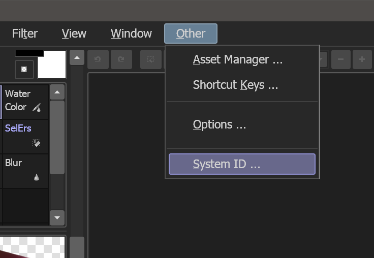
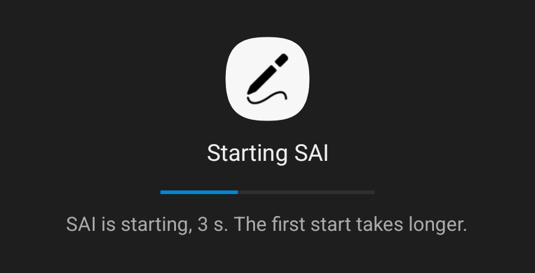
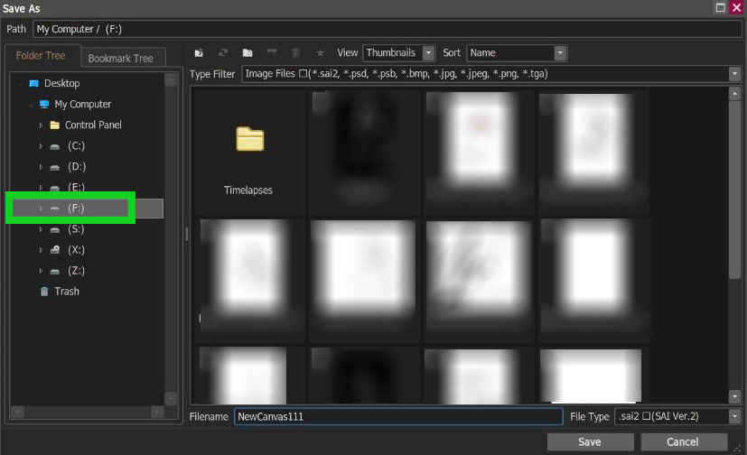
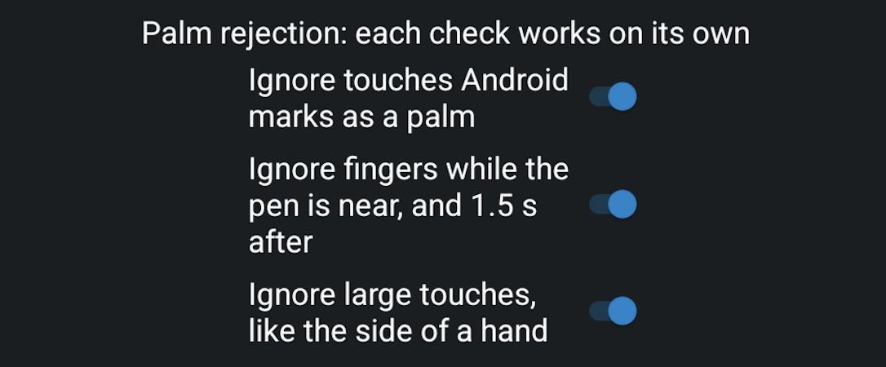
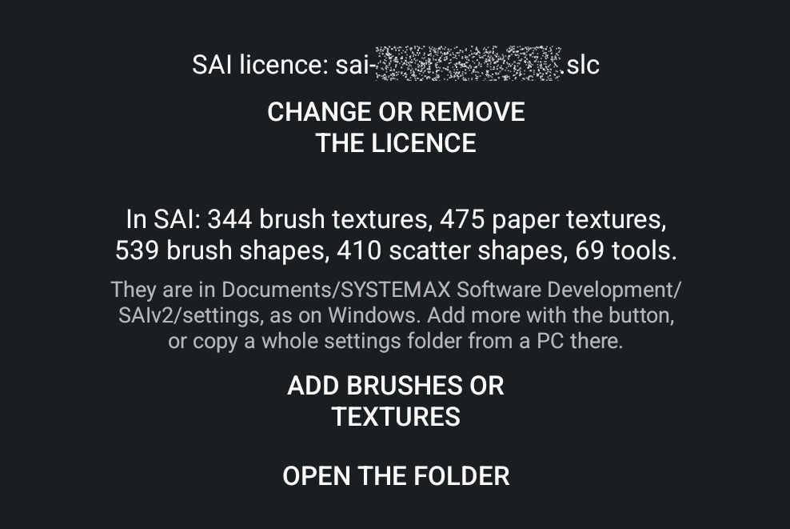

# SAI Pen for Android: PaintTool SAI with S Pen pressure

[](https://github.com/ametrien/Paint-Tool-SAI-pen-pressure-Android/releases/latest)
[](https://github.com/ametrien/Paint-Tool-SAI-pen-pressure-Android/releases)
[](LICENSE)

Run **PaintTool SAI Ver.2** on a Samsung tablet or phone with the **S Pen**, with **real pen
pressure**, and record a **timelapse of your canvas**. Free and open source.

On a Mac? The same, also by me:
**[SAI Pen Pressure for macOS](https://github.com/ametrien/Paint-Tool-SAI-pen-pressure-macOS-fix)**.

> ### 🌱 Maintainer note
>
> This is a hobby project maintained by just one person (me!) for both the macOS and Android
> versions.
>
> In the first 24 hours after [sharing it on Reddit](https://www.reddit.com/r/PaintToolSAI/comments/1y0k3bk/i_made_sai_2_work_on_android_with_pen_pressure/),
> people tested it on their tablets and phones (Galaxy, Xiaomi, Huawei, Wacom, Ugee) and sent reports. Thanks to
> them, 0.4.19 to 0.4.24 brought:
>
> - palm rejection, so a resting hand doesn't draw random lines;
> - turning the canvas with two fingers;
> - your brushes and textures in the device's Documents, and adding brush packs right from
>   SAI Pen's screen;
> - fixes for a pen that left a dot at the start of strokes, drawings that couldn't be found after
>   saving, and Bluetooth keyboards that didn't type into SAI.
>
> 0.4.25 added basic drawing statistics on SAI Pen's screen, and 0.4.26 brings the dedicated
> `F:\` drive for your drawings and fixes opening drawings from SAI's Recent list.
>
> Thank you, everyone!
>
> After weeks of extensive work on the macOS and Android versions in my free time, I now need to
> focus on my personal life, so I'm taking a break now that most things work for most people.
> I'll be back! In the meantime I'll also be drawing in SAI myself, which is testing too.
>
> GitHub issues are closed for now. To report a problem or ask a question, please comment on the
> [Reddit post](https://www.reddit.com/r/PaintToolSAI/comments/1y0k3bk/i_made_sai_2_work_on_android_with_pen_pressure/) instead.
> Replies may take a while. Thank you for your patience and understanding!

## First time? Quick start

1. **Download only the `.apk`** from the
   [latest release](https://github.com/ametrien/Paint-Tool-SAI-pen-pressure-Android/releases/latest)
   (`SAI-Pen-<version>.apk`) and install it. Android asks once to allow installing apps from your
   browser or file manager. You don't need the `sources.tar` or GitHub's "Source code (zip)" and
   "Source code (tar.gz)": those are source code, not the app.
2. **Download SAI Ver.2 from SYSTEMAX:** <https://www.systemax.jp/en/sai/devdept.html>. Use a
   2026 build. **Alpha.2026.10.19** and **Preview.2026.07.02b** are tested and work. Builds from
   before 2026 don't seem to work well (the 2024 and 2019 builds we tried draw without pressure),
   so please don't use them. The full list is under [SAI versions](#sai-versions). Leave the zip
   in Downloads: SAI Pen finds it and unpacks it.
3. **Open SAI Pen.** Allow access to files, wait for the one-time setup (a couple of minutes),
   then tap **Start SAI**.
4. **Make a licence certificate for this device.** Your PC's `.slc` file does not work here,
   because SAI on the device has its own System ID. In SAI open **Other > System ID**:

   

   SAI shows the device's System ID:

   

   On <https://www.systemax.jp/en/license.html> enter that System ID with the licence number and
   password from the email SYSTEMAX sent you when you bought SAI, and download the new
   `sai-....slc`. Put it in Downloads and tap **Add a SAI licence** on SAI Pen's screen. You don't
   buy SAI again. Details: [Your SAI licence](#your-sai-licence).
5. **Everything too small or too big?** In SAI open **Window > Scaling of User Interface** and
   try another size:

   

   SAI Pen's screen also has **SAI's screen sharpness**: a lower one makes everything bigger and
   faster.

   What looks good so far, to start from:

   | Device | SAI's screen sharpness | Scaling of User Interface | How it looks |
   |---|---|---|---|
   | Galaxy Tab S9 FE+ (a user's choice) | 1600, the display's own | 150% | |
   | Galaxy S26 Ultra (the author's choice) | 1080 | 200% | [SAI](docs/images/phone-200.jpg), [the menu](docs/images/phone-200-menu.jpg) |
6. **Try the settings on SAI Pen's screen** and keep what works for you:
   [palm rejection](#palm-rejection) if your hand moves the cursor or clicks, and
   [timelapse](#timelapse) recording on or off.
7. **Saving your artwork: always use drive `F:\`!** When you save your canvas in SAI (**File > Save**
   or **Save As...**), select drive **`F:\`** in the drive list on the left.
   - **`F:\` is the right place:** it maps directly to **Documents/SAI Drawings** on Android.
     Drawings saved to `F:\` appear immediately in your tablet's file manager (Samsung *My Files*
     or Android *Files*), stay safe even if the app is uninstalled, and open reliably from
     SAI's **Recent** list.
   - **DO NOT save directly to `C:\`:** `C:\` is Wine's internal container. Android file managers
     cannot see files on `C:\`, and uninstalling the app permanently deletes everything inside it.
   - **Avoid `D:\` (Downloads):** `D:\` maps to your Android Downloads folder. While accessible on
     Android, clearing your downloads folder could accidentally delete your artwork.
   For the full breakdown of drive letters (`C:`, `D:`, `E:`, `S:`, `F:`), see
   [Where your drawings are & how drives work](#where-your-drawings-are--how-drives-work).
8. **Want custom brushes and textures?** SAI's custom brushes, paper textures, and tool presets live in
   **Documents/SYSTEMAX Software Development/SAIv2/settings** on your tablet (the same folder as on Windows).
   You can install brush pack `.zip` files easily using the **Add brushes or textures** button on the
   SAI Pen launcher screen. See [Your brushes, textures and presets](#your-brushes-textures-and-presets).

It works best with the **Samsung S Pen**. Other pens may work too: see
[Which devices and pens](#which-devices-and-pens).

## About

SAI Pen is made and tested for **Samsung's S Pen**. It will probably work on other Android tablets
and pens too, but expect some problems there (see [Which devices and pens](#which-devices-and-pens)).

It has been tested on PaintTool SAI Ver.2 (64bit) Alpha.2026.10.19 and Preview.2026.07.02b so far
(see [Tested on](#tested-on)).

You install one app and put SAI on the device. The app finds SAI and starts it full screen: the
cursor sits under the pen tip, touching draws, pressing harder draws a thicker line, and two
fingers scroll and zoom the canvas.

This is the Android sibling of
[SAI Pen Pressure for macOS](https://github.com/ametrien/Paint-Tool-SAI-pen-pressure-macOS-fix):
the same pressure DLL inside SAI, the same timelapse recorder.

## What it looks like

SAI on a Galaxy Tab S6 Lite, drawn with the S Pen: the line gets thicker as the pen presses harder.


The SAI Pen screen, where you choose the SAI folder, add a licence and start SAI:


While SAI starts, SAI Pen shows a cover that counts the seconds until SAI is ready:



## Tested on

### Devices

| Device | Android | Result |
|---|---|---|
| Samsung Galaxy Tab S6 Lite (2022), SM-P613 | 14 | pen, pressure, gestures, saving with a licence, timelapse: work |
| Samsung Galaxy S26 Ultra | | without a licence: SAI found by itself, starts, the pen draws with pressure |
| Samsung Galaxy Tab S9 FE+ (tested by a user) | | works |
| Xiaomi Pad 7 Pro, Xiaomi Focus Pen (tested by a user) | | the pen draws with pressure |
| Xiaomi Pad 6 (6 GB), Xiaomi Smart Pen 2nd gen (tested by a user) | 14 | the pen draws with pressure |
| Ugee UT2 (tested by a user on 0.4.18) | | the pen draws with pressure; the pen has no hover, and on 0.4.18 most strokes started with a dot at the full brush size. Probably fixed in 0.4.20 (see below), not yet confirmed on the Ugee |
| Huawei MatePad 11.5 PaperMatte (tested by a user) | | everything works |
| Wacom MovinkPad 14 (tested by a user) | | works great |

### SAI versions

SAI's title bar shows which build you have, like *PaintTool SAI Ver.2 (64bit) Alpha.2026.10.19*.

| SAI Ver.2 (64bit) build | Result | Tested on |
|---|---|---|
| Alpha.2026.10.19 | works, the pen draws with pressure | Galaxy Tab S6 Lite, Galaxy S26 Ultra, Xiaomi Pad 7 Pro, Xiaomi Pad 6, Ugee UT2 |
| Preview.2026.07.02b | works | Galaxy Tab S9 FE+ (by a user) |
| 2024.11.23 | starts, but draws without pressure | |
| 2019.08.12 | starts, but draws without pressure | |

## Which devices and pens

The app needs **Android 8 or newer** on a **64-bit ARM processor** (almost every tablet and phone
of recent years). SAI is a Windows program and runs through Wine and Box64, so a faster device
draws more smoothly: the Galaxy Tab S6 Lite (Snapdragon 720G, 4 GB of memory) works but feels a
little slow.

**Made for the Samsung S Pen.** SAI Pen is built and tested on Samsung devices. Users have also
tried it with the Xiaomi Focus Pen (Pad 7 Pro), the Xiaomi Smart Pen 2nd gen (Pad 6) and the
Ugee UT2 (see [Tested on](#tested-on)). The two Xiaomi pens do not work with each other's tablets.

**Other tablets: expect some problems.** Every maker's pen reports to Android a little
differently, so on other tablets SAI Pen will probably work, but some things may go wrong, like
the stray dot at the start of each stroke on the Ugee UT2 before 0.4.20. Unfortunately the author can't easily fix these: they can only be
reproduced and tested on that device, and the author only has Samsung devices. A report on
[Reddit](https://www.reddit.com/r/PaintToolSAI/comments/1y0k3bk/i_made_sai_2_work_on_android_with_pen_pressure/) still helps, and some problems can be fixed from a good description.

Other Samsung devices with an S Pen should work the same way as the tested ones:

- Samsung tablets with an S Pen: the **Galaxy Tab S** series, **Tab S FE** and **Tab S Lite**.
- Samsung phones with a built-in S Pen: the **Galaxy S Ultra** line (S22 Ultra and newer, such as
  the S24, S25 and S26 Ultra) and the older **Galaxy Note** phones (Note 8 and newer).

**Not tested, but should work in theory:** any pen that tells Android it is a pen and passes the
pressure in the standard way. The app uses no Samsung-only parts, only Android's own pen events.
For example:

- active pens of other tablets: Lenovo Tab Pen and Precision Pen, OnePlus Stylo,
  Honor and Huawei pens;
- USI 2.0 pens on tablets that support them;
- a Wacom pen tablet plugged into the Android device by USB.

**Pens without hover.** Some pens, like the Ugee UT2's, tell Android nothing until they touch the
glass (check with step 4 below). Up to 0.4.19 this made SAI take the first touch of a stroke for a
mouse click and leave a dot at the full brush size. 0.4.20 fixes this: the dots were reproduced on
an S Pen made to ignore its hover (13 of 14 lines) and were gone with the fix (0 of 15). The fix
does not depend on the pen's maker, so it should help most pens without hover, but it has not yet
been confirmed on one.

With such a pen a few things may differ: without hover the cursor shows only while the pen
touches, the side button may be taken by the maker for its own shortcut (then there is no right
click), and an eraser end draws like the tip.

**Will not work: passive styluses.** A stylus with a rubber, mesh or clear disc tip, or a cheap
"active" stylus for any phone that is never paired with the device, has no pressure: Android sees
it as a finger, so there is nothing to pass on to SAI.

If you try a device or pen that is not in the table, please tell us on [Reddit](https://www.reddit.com/r/PaintToolSAI/comments/1y0k3bk/i_made_sai_2_work_on_android_with_pen_pressure/) how it went.

### Check a pen in a minute, without SAI

This works on any Android device, even one in a shop:

1. Turn on **Developer options**: in Settings, open **About phone** (or About tablet; on Samsung
   then **Software information**) and tap **Build number** seven times.
2. In **Settings > Developer options**, turn on **Pointer location**.
3. Draw on the screen with the pen and watch the **`Prs`** number in the bar at the top.

4. Hold the pen just above the screen without touching it and see whether a crosshair follows it.

If `Prs` changes with how hard you press, the pen has pressure and SAI Pen can pass it to SAI.
If it stays at 1.0 or does not change, the pen has no pressure, and SAI Pen will not get any
either. If the crosshair follows the pen above the screen, the pen has **hover**: SAI then shows
its brush circle before you touch. Without hover SAI Pen still works, the circle just shows only
while the pen touches. Turn Pointer location off again afterwards.

When you report a pen, these two answers help a lot: does `Prs` start low on the
first touch or jump to 1.0, and does the crosshair follow the pen above the screen?

## Download

**[Download the latest release](https://github.com/ametrien/Paint-Tool-SAI-pen-pressure-Android/releases/latest)**
and install the file `SAI-Pen-<version>.apk`. That's all you need.

The other file, `SAI-Pen-<version>-sources.tar` (about 400 MB), is the source code of the
open-source parts inside the app (Wine, Box64 and the rest), there for their licences. You don't
need it to use SAI Pen.

> [!WARNING]
> ⚠️ **Updating from 0.4.22 or older? Get your drawings out first.** Before 0.4.23, drawings saved
> in SAI's own folders (`C:\users\xuser`, its Desktop, Documents or Pictures) stay inside the app,
> and **uninstalling SAI Pen deletes them**. Installing the new APK over the old one keeps them,
> and the first start of 0.4.23 or newer moves them to **Documents/SAI Drawings**. But if the
> update fails and you uninstall the app to get it in, they are gone.
>
> So before you update (and always before you uninstall): open SAI, save each drawing into the
> "SAI Drawings" folder, close SAI, and check in the device's Files app that they are in
> **Documents/SAI Drawings**. Only then update or uninstall.

Every version is a GitHub release with its own tag (`v0.4.0`, `v0.4.1`, ...), the same way as the
macOS project. The app is not in Google Play.

## Using it

1. **Install the APK.** Android asks once to allow installing apps from your browser or file
   manager.
2. **Put SAI on the device.** Download it from <https://www.systemax.jp/en/sai/devdept.html>, then
   unpack the zip or leave it in Downloads and let the app unpack it. SAI needs its whole folder
   (`sai2.exe`, `sai2.ini` and `init`), not only `sai2.exe`.
3. **Open SAI Pen** and go through the first start (below). Then tap **Start SAI**.
4. **Make a licence certificate for this device.** Your PC's `.slc` file does not work here: a
   certificate is made for one System ID, and SAI on the device has its own. In SAI open
   **Other > System ID**, then make a new certificate on SYSTEMAX's site with the licence number
   and password from the email you got when you bought SAI. You don't buy SAI again. Step by step
   in [Your SAI licence](#your-sai-licence).
5. **Save your drawings** into the "SAI Drawings" folder of SAI's save dialog. On the device it is
   **Documents/SAI Drawings**. Saved somewhere else by mistake? See
   [Where your drawings are](#where-your-drawings-are).

### The first start, step by step

SAI Pen asks before it looks at anything, and asks about SAI and about the licence separately:

1. **Access to files.** Android asks once. SAI Pen needs it to read SAI's folder and to save
   your drawings in Documents.
2. **Wine is unpacked** inside the app (a couple of minutes, once).
3. **Where is SAI?** Either **Search the device**: SAI Pen looks through the device storage, up
   to four folders deep (and `Android/media`, where messaging apps such as WhatsApp or Telegram
   keep received files), for a folder with `sai2.exe`, `sai2.ini` and `init` (or for a SAI zip
   to unpack). Or **Choose the folder** yourself. Only SAI is looked for here.
4. **SAI found.** The screen shows the folder and a **Start SAI** button. SAI does not start
   by itself.
5. **The licence, a question of its own.** **Look for it**: SAI Pen looks for a `sai*.slc` file
   in Downloads and in SAI's folder, shows the one it found, and uses it only if you say so.
   **Choose the file**: pick it yourself. **Without a licence**: try SAI first, add the licence
   later with **Add a SAI licence**.

Nothing leaves the device. SAI Pen never sends files or the licence anywhere.

**Start SAI right away** (a switch under Start SAI, off at first): turn it on to skip the app's
screen and start SAI straight from the icon. While it is off, the icon always opens the app's
screen with the settings.

### Where your drawings are & how drives work

SAI runs inside the app using Wine (a Windows compatibility layer). Wine assigns virtual drive letters (`C:`, `D:`, `E:`, `S:`, `F:`) that map to different folders on your Android device:

| Drive in SAI | Where it is on Android | What it is for |
|---|---|---|
| **`F:\`** | **`Documents/SAI Drawings`** | **Your drawings!** The primary, safe place for all your artwork. |
| **`C:\users\xuser\SAI Drawings`** | **`Documents/SAI Drawings`** | Direct shortcut inside the Windows user folder pointing to your drawings. |
| **`C:\users\xuser\Documents\SYSTEMAX Software Development\SAIv2\settings`** | **`Documents/SYSTEMAX Software Development/SAIv2/settings`** | **Your brushes, textures & presets!** Linked directly to Android Documents. |
| **`D:\`** | **`Download`** (Internal Storage) | Your device's **Downloads** folder (where you download zips, brushes, etc.). |
| **`E:\`** | **`Internal Storage`** (Device Root) | The root of your Android internal storage. |
| **`S:\`** | SAI program folder (`sai2.exe`) | The folder where PaintTool SAI itself is installed. |
| **`C:\`** (other than the linked folders above) | Internal Wine container | Private app storage. Invisible to Android file managers and deleted if the app is uninstalled. |

In SAI's Save As window, choose **`F:\`** from the drive list:



That is the same folder you see in Android's file manager at **Documents/SAI Drawings**:


> [!NOTE]
> **What about brushes, paper textures, and presets?**
> SAI Ver.2 stores custom brushes, paper textures, blotmaps, and swatches in
> **`Documents/SYSTEMAX Software Development/SAIv2/settings`**. SAI Pen links this folder directly to Android's
> Documents, so your brush collection also survives app updates and uninstalls. You can install brush pack `.zip` files
> easily using the **Add brushes or textures** button on SAI Pen's launcher screen (see [Your brushes, textures and presets](#your-brushes-textures-and-presets)).

---

### How to save and open your artwork

#### 🎨 Saving a drawing
1. In SAI, click **File > Save** (or **Save As...**).
2. Look at the drive list on the left side of the file dialog:
   - **Recommended:** Click on drive **`F:\`** (or go to `C:\users\xuser\SAI Drawings`).
   - Give your file a name and click **Save**.
3. Your drawing is instantly saved directly to **Documents/SAI Drawings** on your tablet/phone. You can find it in the Samsung "My Files" (or Android "Files") app right away.

> [!TIP]
> **Why not save to `D:\` (Downloads)?**
> The `D:\` drive is your Android Downloads folder. Cleaning out your downloads folder could accidentally delete your drawings if you keep them there. Always prefer **`F:\`**!

#### 📂 Opening a drawing
- **Using File > Open:** Choose drive **`F:\`** in the file browser. All your `.sai2`, `.psd`, and exported image files are right there.
- **Using Recent Files:** You can open your work directly from SAI's **Recent** list! Even if a drawing was originally saved into `C:\users\xuser`, SAI Pen keeps the in-app file intact so SAI can find and open it from history.
- **From Android:** In your tablet's file manager, go to **Documents > SAI Drawings** (or tap **Open Documents/SAI Drawings** on the SAI Pen launcher screen).

---

### What happens if you accidentally saved to `C:\` or Desktop?

Because SAI defaults to opening `C:\users\xuser`, it is easy to accidentally hit save right there. **SAI Pen protects you from losing drawings:**

1. While SAI is running, drawings saved in `C:\users\xuser` (or its Desktop, Documents, Pictures folders) remain inside Wine.
2. When you close SAI (or before SAI starts next time), SAI Pen automatically **copies** all your artwork (`.sai2`, `.sai`, `.psd`, `.png`, `.jpg`, etc.) into **Documents/SAI Drawings** on your device.
3. **The original remains on `C:\`**: Previous versions of SAI Pen removed the in-app file, which broke SAI's **Recent** list. Now, the in-app copy stays so that Recent files continue to open properly.
4. **Nothing is lost or overwritten**: If a file with the same name already exists in `Documents/SAI Drawings`, the new copy is saved as `name (2).sai2`. If moving fails, the drawing is never deleted.

### Gestures

| Gesture | Does |
|---|---|
| S Pen on the glass | draws, with pressure; the side button gives a right click |
| One finger | puts the cursor under itself and clicks |
| Two fingers, moving | scroll the canvas in any direction |
| Two fingers, pinch | zoom |
| Three-finger tap | opens the keyboard |
| Four-finger tap | the menu (keyboard, close SAI, settings) |

### Palm rejection

**Always on, nothing to set:** a hand resting on the glass never interrupts a stroke. While the pen
draws, a palm or finger that lands is ignored, and fingers already on the glass when the pen
arrives are let go, so the pen keeps the cursor.

**Extra checks, since 0.4.19, all off by default.** Without them, a palm that touches while the pen
is *not* drawing works like a finger: it can move the cursor and click. If that happens to you,
turn on the checks you need on the app's screen, under **Palm rejection**, before starting SAI.
Each works on its own:

- **Ignore touches Android marks as a palm.** Uses the device's own palm detection, so how well it
  works depends on the device.
- **Ignore fingers while the pen is near, and 1.5 s after.** Fingers do nothing while the pen
  hovers or draws. Gestures with two or more fingers still work once the pen is away.
- **Ignore large touches, like the side of a hand.** A contact wider than a fingertip is ignored.



### Timelapse

Turn on **Record a timelapse** on the app's screen before starting SAI. Our DLL inside SAI saves a
frame of the canvas when the pen rests. Later, on the app's screen, **Make a timelapse video**
turns the frames into an MP4 per canvas in **Documents/SAI Drawings**.

### Your brushes, textures and presets

Artists share **brush packs** online, on r/PaintToolSAI or DeviantArt for example: a `.zip` of
small pictures (`.bmp`) that give SAI's brushes a texture or a shape, like canvas grain, pencil,
bristles, splatters or leaves. SAI keeps them, with your tools and presets, in
**Documents/SYSTEMAX Software Development/SAIv2/settings** on the device, the same place as on
Windows. SAI Pen's screen shows what SAI has and has two buttons for it (since 0.4.22):



#### Add a brush pack, step by step

1. **Get the pack onto the device.** Download its `.zip` on the device, or send it there from a
   computer (USB cable, Google Drive, Quick Share, email, a messenger). A pack kept as a folder on
   Google Drive comes down as a `.zip` when you download the whole folder on a computer.
2. **Open SAI Pen** (close SAI first if it is open) and scroll down to the line that starts with
   **In SAI:**.
3. **Tap Add brushes or textures.** Android's file picker opens. Open **Downloads**, or wherever
   the pack is, and tap the `.zip`. Loose pictures work too: touch and hold one, tap the others,
   then tap **Select**.
4. **Check what SAI Pen found and tap Add.** It sorts the pictures into SAI's folders by the
   pack's folder names (`brushtex`, `papertex`, `scatter`, `blotmap`, `bristle`, `brshape`).
   Pictures SAI already has stay as they are, and nothing but `.bmp` and `.ini` files is taken
   from a pack, never a program.

   

   Pictures that are not in such folders get a question first: are they brush textures, paper
   textures, brush shapes or scatter shapes? The pack's description usually says.
5. **Tap OK and start SAI.** The count on SAI Pen's screen has gone up.

   

6. **Pick them in SAI:**

   | What you added | Where you pick it in SAI |
   |---|---|
   | Brush textures | choose a brush, then the **[ No Texture ]** list in its settings |
   | Brush shapes | choose a brush, then the **[ Simple Circle ]** list in its settings |
   | Paper textures | Layer Effect, **Paper** |
   | Scatter shapes | the **Scatter** tool |

#### Bring your tools and presets from a PC

Your own tools, presets, brushes and textures are SAI's whole `settings` folder on the PC:

1. On the PC, in File Explorer open **Documents > SYSTEMAX Software Development > SAIv2**,
   right-click `settings` and choose **Send to > Compressed (zipped) folder**.
2. Send `settings.zip` to the device: USB cable, Google Drive, Quick Share, email or a messenger.
3. On SAI Pen's screen tap **Add brushes or textures**, pick `settings.zip` and tap **Replace**.
   SAI's settings on the device are kept beside it as `settings-before-` and the date.
4. Start SAI. The PC's settings bring the PC's window size and position, so the first time SAI
   may open smaller or off to one side. Maximize it once and SAI remembers.

#### By hand

**Open the folder** on SAI Pen's screen opens it in the Files app. A pack's `.bmp` and `.ini`
files go into the folders of the same name in `settings` (`blotmap`, `bristle` and `brshape` are
in `brushfom`), and a PC's `settings` folder goes in place of the one there. Replace that one as
a whole rather than mixing two: SAI numbers its tools, so two sets can mix up the tool panel.
New files show up in SAI after it starts again.

#### Tested

Tested on a Galaxy Tab S6 Lite with a settings folder from another computer (its tools, brush
values and window came along) and with the
[Brush Collection](https://www.reddit.com/r/PaintToolSAI/comments/1qb1dix/brush_collection_updated/)
from r/PaintToolSAI: all 2,195 textures and brush shapes (611 MB) show up in SAI, and SAI is
ready in about 8 seconds, as without them. The collection's `SaiBristleCorrector.exe` is a
Windows program and is not needed. The buttons were tried on the same tablet with a pack's zip,
a loose picture and a zipped settings folder from another computer.


The first start of 0.4.21 moves the settings SAI already had inside the app to that folder. If
you have put a `settings` folder there first, yours is used, and the one from inside the app is
kept inside the app as a backup. Since the folder is outside the app, your brushes stay when you
uninstall SAI Pen.

### Your SAI licence

Without a licence certificate SAI Ver.2 does not save or open files. A certificate is made for
one System ID, and SAI on the device has its own, so the `.slc` from your PC does not work here.
A new certificate for the device's System ID is all it takes, with the licence you already have:

1. Start SAI on the device and open **Other > System ID**. Note the System ID it shows.

   

   

2. Find the email SYSTEMAX sent when you bought SAI: it has your **licence number** and
   **password**.
3. On <https://www.systemax.jp/en/license.html> enter the licence number, the password and the
   device's System ID, and download the certificate (`sai-....slc`).
4. Put it in **Downloads** on the device, tap **Add a SAI licence** on the app's screen and then
   **Look for it**, or **Choose the file** wherever it is. Once you have said yes to a found
   licence, a newer `sai*.slc` that later lands in Downloads (a new System ID, say) is taken by
   itself at the next start.

On SAI Pen's screen the licence number is hidden under a spoiler, so a screenshot of the screen
does not show it. Tap it to see the number.

Updating SAI Pen keeps the installed certificate. Uninstalling the app removes it together with
Wine; the copy in Downloads stays, and **Look for it** finds it again.

## What it is built on

SAI Pen is a changed version of **[Winlator](https://github.com/brunodev85/winlator-app)** 11.2
(commit `ecd5ab2`, see `UPSTREAM`), an Android app by brunodev85 that runs Windows programs with
Wine and the Box64 emulator. Inside the APK:

| Part | What it does here | Licence |
|---|---|---|
| [Winlator](https://github.com/brunodev85/winlator-app) 11.2 | the Android app around everything: X server, screen, touch input | LGPL-2.1 |
| [Wine](https://www.winehq.org) 10.10 | runs SAI, a Windows program | LGPL-2.1 or later |
| [Box64](https://github.com/ptitSeb/box64) 0.4.4 | runs x86-64 code on the device's ARM processor | MIT |
| [Mesa](https://www.mesa3d.org), [DXVK](https://github.com/doitsujin/dxvk), [VKD3D-Proton](https://github.com/HansKristian-Work/vkd3d-proton) | graphics drivers Winlator ships | MIT, zlib, LGPL-2.1 |
| Our `wintab32.dll`, from [SAI Pen Pressure for macOS](https://github.com/ametrien/Paint-Tool-SAI-pen-pressure-macOS-fix), the Mac version of this project | inside SAI: gives it the pen pressure and records the timelapse | GPL-3.0 with our terms |
| Our `winhandler.exe` (`winhandler/`) | inside Wine: starts SAI and answers the app (windows, clipboard, processor cores) | GPL-3.0 with our terms |
| SAI Pen's own code (`src/`, `patches/`) | the pen, gestures, the launcher screen, the timelapse video | GPL-3.0 with our terms |

[THIRD_PARTY.md](THIRD_PARTY.md) lists every part inside the APK with its version, licence and
source. [ARCHITECTURE.md](ARCHITECTURE.md) explains how the parts fit together.

### How it works


SAI is a Windows program for x86-64 processors. Wine gives it Windows, Box64 turns its x86-64 code
into ARM code as it runs, and Winlator's X server shows its window. The pen goes two ways at once:
the position and the touch as a mouse through the X server, and the pressure (UDP `127.0.0.1:47800`)
straight to our `wintab32.dll` inside SAI, which hands it to SAI the way a Wacom tablet driver
would. The same DLL saves the canvas for the timelapse, which the app turns into a video. Our
`winhandler.exe` starts SAI and answers the app (UDP 7946/7947): windows to the front, clipboard,
processor cores.

We looked for another way to get S Pen pressure into SAI on Android and did not find one
(November 2026): Winlator and its forks pass the S Pen as a mouse, without pressure.

### What it changes in Winlator

- **The S Pen is a pen.** In Winlator the S Pen moves the cursor like a laptop touchpad, and a
  pen that is held down and moving never holds the mouse button. Here the cursor sits under the
  tip, touching holds the left button, and the side button gives a right click.
- **Pressure reaches SAI.** Every pen sample, including the ones Android batches together, goes
  over UDP `127.0.0.1:47800` to our `wintab32.dll` inside SAI. That DLL tells SAI the pressure
  through WinTab. Before each session the app copies the DLL into the Wine prefix and sets
  `wintab32=native,builtin`.
- **Fingers.** One finger puts the cursor under itself. Two fingers scroll the canvas in any
  direction and pinch to zoom.
- **One screen instead of Winlator's.** No containers to set up: the app finds SAI, prepares
  Wine for it and starts it, and comes back to its own screen when SAI closes.
- **Its own package** (`sai.penpress`), so it installs next to Winlator. Winlator's prebuilt files
  have its own data folder compiled in. The build rewrites that path in place, so the new package
  name must be exactly as long as `com.winlator`.

## Licences

In short: SAI Pen is free and open source, everything inside it may be passed on, and the source
code of every part is published. Nothing of Microsoft's and no part of SAI is in the app.

<picture>
  <source media="(prefers-color-scheme: dark)" srcset="docs/images/licences-dark.svg">
  
</picture>

The source of every part under the GPL or the LGPL is attached to each release; the copyright
notices of the parts under permissive licences are in `LICENSES.txt`.

**Our code.** SAI Pen for Android is licensed under the **GNU General Public License, version 3**
([LICENSE](LICENSE)), with additional terms under its section 7 ([NOTICE](NOTICE)):

- keep `NOTICE` and the credit "SAI Pen Pressure by ametrien" with a link to
  <https://github.com/ametrien/Paint-Tool-SAI-pen-pressure-macOS-fix>;
- mark a changed version as changed, and do not present it as the original.

The GPL lets anyone use, share and change the app, also for money, as long as whatever they pass
on stays under the same licence with its full source code. Nobody can turn this code into a
closed app.

**What it is built on.** Winlator is LGPL-2.1, and LGPL-2.1 (section 3) allows conveying it under
the GPL, so the whole app goes out under GPL-3.0. Every other part (Wine, Box64, the Linux
libraries, the audio and graphics libraries) keeps its own licence and copyright notice:

- [THIRD_PARTY.md](THIRD_PARTY.md) lists every part inside the APK, its version, its licence and
  where its source is;
- [LICENSES.txt](LICENSES.txt) holds the full text of every licence and every copyright notice.
  The app shows the same file under **Licences**.

**Source code of every part.** Each release carries, next to the APK, the source archive of every
part under the GPL or the LGPL, with a `SHA256SUMS` file. `tools/fetch-sources.py` downloads the
same archives and checks them against `third_party/sources.tsv`. Our own source is this
repository at the release's tag, and `build.sh` builds the APK from it.

**What is left out, and why.**

- **Microsoft's files.** Winlator ships Microsoft's DirectX parts, Visual C++ runtimes, fonts and
  MFC. Their licences do not let anyone pass them on, so the build removes them, and it fails if
  any of them comes back. SAI does not need them.
- **The Fraunhofer FDK AAC codec.** Its licence does not go with the GPL. SAI does not need it.
- **Winlator's extra programs** (7-Zip, its file manager, test and download tools). SAI does not
  use them, and some have no published source.
- **Winlator's `winhandler.exe`**, the helper that starts SAI inside Wine, as its source is not
  published. SAI Pen has its own, written for this project (`winhandler/`).

**The icon** is "Pen" by gravisio from Flaticon
([Drawing icons created by gravisio - Flaticon](https://www.flaticon.com/free-icons/drawing)),
used under Flaticon's free licence with this credit. It is not under the GPL.

**PaintTool SAI** is proprietary software by SYSTEMAX Software Development and is **not**
included: everyone downloads it from SYSTEMAX and uses their own licence. Samsung and S Pen are
trademarks of Samsung Electronics. This project is not affiliated with SYSTEMAX, Samsung or
Winlator.

## Build from source (macOS)

Needs JDK 17, the Android SDK with NDK `24.0.8215888`, CMake `3.22.1` and platform 35, and `zstd`.

```bash
./build.sh            # tests, then dist/SAI-Pen-<version>.apk
./build.sh test       # tests only
```

The Winlator checkout lives outside the repository, in `~/Documents/sai-android-build` (change it
with `SAIPEN_WORK`). To change a Winlator file, edit it in `winlator-app/` there, then run
`./build.sh save-patches`.

| Path | What |
|---|---|
| `UPSTREAM` | Winlator repository and commit we build on |
| `patches/winlator.patch` | our changes to Winlator's own files |
| `src/` | our new Java classes (`com.winlator.saipen`), resources and their JVM tests |
| `tools/rewrite_tar.py` | rewrites the data path inside Winlator's archives |
| `tools/make-icon.swift` | draws the app icon: the pen by gravisio from Flaticon on a light tile |
| `winhandler/` | our `winhandler.exe`, which starts SAI inside Wine and answers the app |
| `tools/fetch-sources.py`, `third_party/sources.tsv` | the source archives attached to each release |
| `tests/` | the DLL side of the pen wire check, winhandler's protocol, what the archive rewrite leaves out |
| `third_party/wintab/` | `wintab32.dll` from the macOS project (see `SOURCE.txt`) |

## Support

The best support is simply using SAI Pen and telling me what goes wrong: on
[Reddit](https://www.reddit.com/r/PaintToolSAI/comments/1y0k3bk/i_made_sai_2_work_on_android_with_pen_pressure/)
(GitHub issues are closed for now). If you'd really like to do
more, you can [buy me a coffee on Ko-fi](https://ko-fi.com/ametrien).
