# SAI Pen for Android: PaintTool SAI with S Pen pressure

[](https://github.com/ametrien/Paint-Tool-SAI-pen-pressure-Android/releases/latest)
[](https://github.com/ametrien/Paint-Tool-SAI-pen-pressure-Android/releases)
[](LICENSE)

Run **PaintTool SAI Ver.2** on a Samsung tablet or phone with the **S Pen**, with **real pen
pressure**, and record a **timelapse of your canvas** (experimental). Free and open source.

On a Mac? The same, also by me:
**[SAI Pen Pressure for macOS](https://github.com/ametrien/Paint-Tool-SAI-pen-pressure-macOS-fix)**.

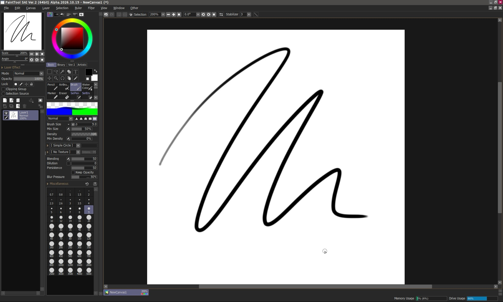

▶ **[Watch the demo on YouTube](https://www.youtube.com/watch?v=ykKtWa-FKVk)**:
[0:00](https://www.youtube.com/watch?v=ykKtWa-FKVk) SAI Pen ·
[1:44](https://www.youtube.com/watch?v=ykKtWa-FKVk&t=104s) starting PaintTool SAI Ver.2 ·
[2:24](https://www.youtube.com/watch?v=ykKtWa-FKVk&t=144s) a new canvas

> [!NOTE]
> **A fan project, with respect to SYSTEMAX.** If SYSTEMAX ever asks, I'll gladly take it down.
>
> <details>
> <summary>More</summary>
>
> SAI Pen is a **fan project**, made out of love for PaintTool SAI. I've been using SAI for around
> 15 years, and having it on Android and macOS was a dream of mine, so this project is my humble
> attempt at it. All my thanks go to SYSTEMAX for creating SAI. **If SYSTEMAX ever asks, I'll
> gladly take this project down.**
>
> </details>
>
> <details>
> <summary><b>日本語</b></summary>
>
> SYSTEMAX様へ、心からの敬意と感謝を込めて。
>
> 本プロジェクトは、約15年にわたりPaintTool SAIを愛用させていただいている一ファンが、SAIへの深い愛情から個人的に制作いたしました、非公式のファンプロジェクトでございます。SAIをAndroidやmacOSでも使わせていただけたら、というのが長年の夢であり、本プロジェクトはその夢を形にしようとした、ささやかな試みにすぎません。
>
> このような素晴らしいソフトウェアを生み出し、長年にわたり大切に開発を続けてくださっているSYSTEMAX様に、心より御礼申し上げます。
>
> 万が一、本プロジェクトがご迷惑となる場合や、SYSTEMAX様より公開停止のご要望をいただいた場合には、直ちに公開を取り下げさせていただきます。何卒よろしくお願い申し上げます。
>
> </details>

> [!WARNING]
> **Not official, no guarantees:** use it at your own risk.
>
> <details>
> <summary>Please read</summary>
>
> - **Not official.** SAI Pen is **not affiliated with SYSTEMAX** (the makers of SAI) or Samsung.
>   I made it for fun because I love SAI.
> - **Not guaranteed to work** on your device. It's maintained by one person, and with so many
>   tablets, phones and pens a lot can go wrong. **There are bugs, and there will be more.**
> - **Most features should work for most people**, but not everything works everywhere.
> - **There may be lag**, depending on your device.
> - **Use it at your own risk.** SAI Pen is provided as is, and I'm not responsible for any
>   purchases (such as a SAI licence), lost work or other problems that come from using it.
>
> </details>

> 🌱 **A hobby project by one person (me!).** Questions and problems:
> [Reporting a problem](#reporting-a-problem).
>
> <details>
> <summary>What's new, 0.4.19 to 0.5.0</summary>
>
> Made in my free time, together with the
> [macOS version](https://github.com/ametrien/Paint-Tool-SAI-pen-pressure-macOS-fix). After the
> first release on Reddit, these came thanks to your comments and reports. Thank you, everyone!
>
> - **0.4.19:** palm rejection switches, two-finger rotation of the canvas.
> - **0.4.20:** no more full-size dot at the start of a stroke with pens that have no hover.
> - **0.4.21, 0.4.22:** SAI's brushes, textures and presets in the device's Documents, and adding
>   brush packs and textures on SAI Pen's screen.
> - **0.4.23, 0.4.26:** drawings go to Documents/SAI Drawings, drive F: in SAI's save dialog,
>   and they show up right away in the Files app.
> - **0.4.24, 0.4.27:** Bluetooth keyboards work in SAI, also Tab and Shift+Tab.
> - **0.4.25, 0.4.27:** drawing statistics, with their own window and a CSV file.
> - **0.4.27:** SAI stays open when you switch apps, a sharper screen, a redesigned SAI Pen screen.
> - **0.4.28:** on-screen keys for SAI without a keyboard (Ctrl, Ctrl+Z, Enter and your own).
> - **0.4.29:** less lag: the front buffer and one frame per refresh of the display
>   (Settings, *Screen drawing*); a check of whether the device is ready to draw; the 32-bit SAI
>   is recognised; *Change SAI…* lists every SAI on the device.
> - **0.4.30:** the new button window of the on-screen keys can be read; *Screen drawing* is
>   *Standard* by default, the front buffer is yours to try.
> - **0.4.31:** the timelapse keeps the whole drawing: no more lost frames in long sessions, and
>   a new SAI start no longer mixes into an older video. One video per drawing, every session of
>   it in order, in the new *My timelapses* window.
> - **0.4.32:** choose what each finger and pen gesture does (*Gestures* on SAI Pen's screen, or
>   hold four fingers still over SAI), for example a two-finger tap to undo.
> - **0.4.33:** SAI in Japanese (日本語) or English, by default as the device, and Japanese,
>   Chinese and Korean text instead of boxes (*Language* on SAI Pen's screen). SAI opens full
>   screen every time.
> - **0.4.34:** bring all your settings from a PC in one go, and browse SAI's brushes, textures,
>   shapes and tool sets with previews (*Brushes and textures* on SAI Pen's screen). *About SAI
>   Pen*: your gestures as set and where drawings go. Discard a timelapse without a video. SAI
>   uses less of the processor, and a warning when battery saver or heat slows it down.
> - **0.4.35:** less lag: SAI sees only as many processors as the device has fast cores, so every
>   piece of a stroke runs on a fast one (*Processors SAI sees* on SAI Pen's screen, with the
>   device's cores drawn as bars).
> - **0.4.36:** a Bluetooth S Pen (Galaxy S24 Ultra and older Ultras, most Tab S6 to S10) undoes
>   with one press of its button away from the screen and redoes with two, through Samsung's
>   [Air actions](#bluetooth-s-pen-undo-and-redo-from-the-air).
> - **0.4.37:** [choose which brushes and textures SAI lists](#choose-which-ones-sai-lists), so a
>   big collection doesn't make its lists thousands long; brush samples follow pen pressure (a
>   line, an S-curve or a heart), and *Try it* draws with a tool right on its page.
> - **0.4.38:** better [palm rejection](#palm-rejection): no stray lines from the palm to the pen,
>   and a palm resting on the glass no longer picks colours or leaves dots; a two-finger tap no
>   longer leaves a dot; steadier two-finger zoom, scroll and turn. *Processors SAI sees* shows
>   each core's strength (the fastest is 100%).
> - **0.5.0:** your recent drawings on SAI Pen's screen; *All drawings* to search, sort, swipe
>   through, share and delete them, with their timelapses; time spent on each drawing. The
>   timelapse is made while you draw, has no stripes from fills or the eraser, and finds its
>   drawing by how it looks even after a rename. A *Pen pressure* slider for a lighter touch.
>   SD cards and USB drives as H: and on in SAI. *Try it* draws a line, S-curve or heart with
>   every brush, texture and shape. A red *Exit SAI* key, and less processor use while idle.
>
> </details>

> [!TIP]
> **Less lag since 0.4.35: by default, SAI sees only the fast processor cores.** SAI splits each
> stroke into one piece per processor it sees. By default SAI Pen now shows SAI as many as the
> device has fast cores (at least 2), so every piece can run on a fast one. On a Galaxy Tab S6
> Lite, SAI needed about 30% less of the processor for the same strokes, and the slowest strokes
> caught up with the pen sooner. On a Galaxy Tab S9 FE+, a user said the brushes that used to lag
> work much better since then. Nothing changes in how SAI looks or draws.
>
> You can change it under **Settings > Processors SAI sees** on SAI Pen's screen, which shows the
> device's cores (green fast, yellow slower): another number, or **All** for every core, as before.
>
> <details>
> <summary>SAI's own setting, and SAI Pen 0.4.34 or older</summary>
>
> SAI has the same setting itself: **Other > Options > Environment**, *CPU Cores Assignment* **C**
> and *Number of CPU Cores Used*. Use one or the other: with SAI Pen 0.4.35 or newer, leave SAI's
> own setting on **A** (its default).
>
> With 0.4.34 or older, set it in SAI: choose **C**, set the number of **fast** cores your device
> has (at least 2; search the web for your processor and "cores", the Galaxy Tab S6 Lite has 2),
> press **OK** and restart SAI. Keep **Drawing** under *Settings > Fast processor cores* on SAI
> Pen's screen.
>
> 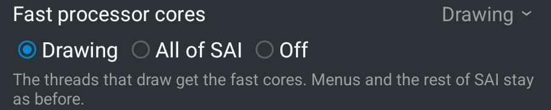
>
> 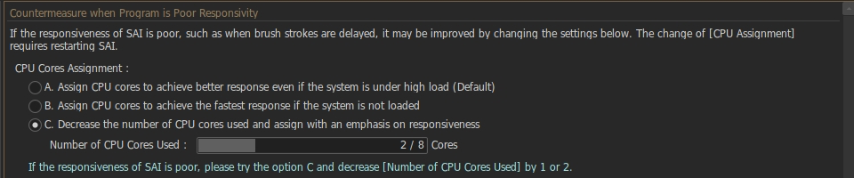
>
> </details>

## Contents

[Quick start](#first-time-quick-start) ·
[FAQ](#faq) ·
[Where your drawings are](#where-your-drawings-are--how-drives-work) ·
[Gestures and keyboard](#gestures-and-keyboard) ·
[On-screen keys](#on-screen-keys-ctrl-ctrlz-ctrlt) ·
[Palm rejection](#palm-rejection) ·
[Timelapse](#timelapse) ·
[Brushes](#your-brushes-textures-and-presets) ·
[Licence](#your-sai-licence) ·
[Devices and pens](#which-devices-and-pens) ·
[Tested on](#tested-on) ·
[Reporting a problem](#reporting-a-problem) ·
[How it works](#what-it-is-built-on) ·
[Licences](#licences)

## First time? Quick start

1. **Download only the `.apk`** from the
   [latest release](https://github.com/ametrien/Paint-Tool-SAI-pen-pressure-Android/releases/latest)
   (`SAI-Pen-<version>.apk`) and install it. Android asks once to allow installing apps from your
   browser or file manager. You don't need the `sources.tar` or GitHub's "Source code" files:
   those are source code, not the app.
2. **Download SAI Ver.2 from SYSTEMAX:** <https://www.systemax.jp/en/sai/devdept.html>.
   - Take the **64bit** version (its file name ends in `64bit-en.zip`).
   - Use a **2026 build**: **Alpha.2026.10.19** and **Preview.2026.07.02b** are tested and work.
     Older builds draw without pressure (see [SAI versions](#sai-versions)).
   - Leave the zip in Downloads: SAI Pen finds it and unpacks it.

   <details>
   <summary>Screenshot: the 64bit download</summary>

   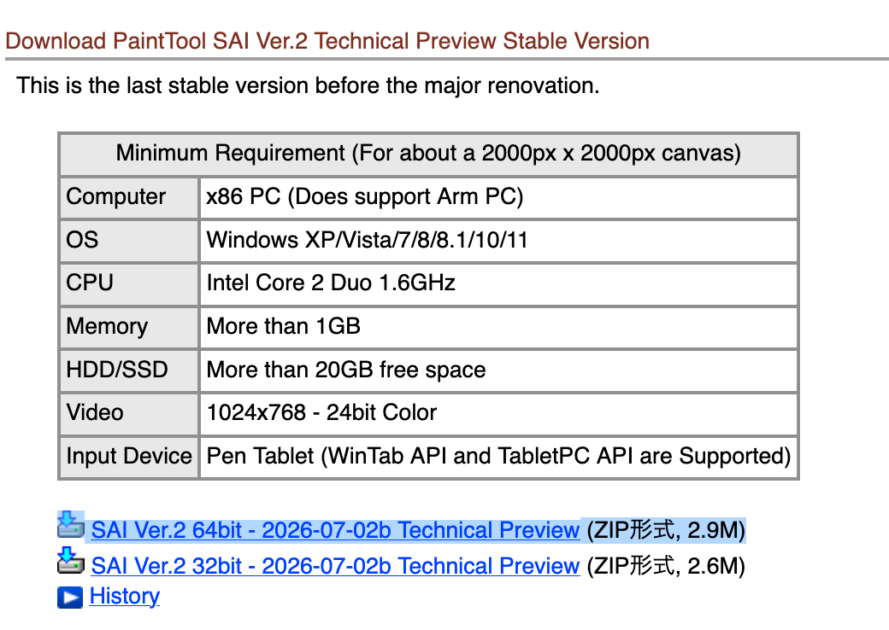

   </details>

3. **Open SAI Pen.** Allow access to files, wait for the one-time setup (a couple of minutes),
   then tap **Start SAI**.
4. **Make a licence certificate for this device.** Your PC's `.slc` file does not work here,
   because SAI on the device has its own System ID. It's free, you don't buy SAI again:
   step by step in [Your SAI licence](#your-sai-licence). You can try SAI first without one:
   like SAI on a PC, it runs without a licence but does not save.
5. **Everything too small or too big?** In SAI open **Window > Scaling of User Interface**. SAI
   Pen's screen also has **SAI's screen sharpness**: a lower one makes everything bigger and
   faster.

   <details>
   <summary>Settings that look good so far, and a screenshot</summary>

   | Device | SAI's screen sharpness | Scaling of User Interface | How it looks |
   |---|---|---|---|
   | Galaxy Tab S9 FE+ (a user's choice) | 1600, the display's own | 150% | |
   | Galaxy S26 Ultra (the author's choice) | 1080 | 200% | [SAI](docs/images/phone-200.jpg), [the menu](docs/images/phone-200-menu.jpg) |

   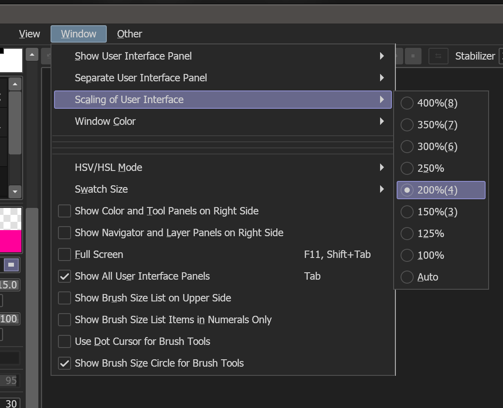

   </details>

6. **Finger taps:** **two fingers** tapped together give a **right click** (so does the pen's side
   button). **Three fingers** open the keyboard, to type a file name or a canvas size: tap the box
   first. **Four fingers** open the side menu on the left; held still for a moment, they open the
   gesture settings, to change what each gesture does.
7. **Save your drawings on drive `F:\`.** In SAI's **Save As** window pick **`F:\`** in the drive
   list. That is **Documents/SAI Drawings** on your device, and it stays there even if you uninstall
   the app. Never save straight on `C:\`. More in
   [Where your drawings are](#where-your-drawings-are--how-drives-work).

That's it! Optional: [palm rejection](#palm-rejection), [timelapse](#timelapse) and
[your own brushes](#your-brushes-textures-and-presets) are on SAI Pen's screen.

<details>
<summary><b>The first start in detail</b> (what SAI Pen asks and why)</summary>

SAI Pen asks before it looks at anything, and asks about SAI and about the licence separately:

1. **Access to files.** Android asks once. SAI Pen needs it to read SAI's folder and to save
   your drawings in Documents.
2. **Wine is unpacked** inside the app (a couple of minutes, once).
3. **Where is SAI?** Either **Find it for me**: SAI Pen looks through the device storage, up
   to four folders deep (and `Android/media`, where messaging apps such as WhatsApp or Telegram
   keep received files), for a folder with `sai2.exe`, `sai2.ini` and `init` (or for a SAI zip
   to unpack). Or **Choose the folder** yourself. SAI needs its whole folder, not only `sai2.exe`.
4. **SAI found.** The screen shows the folder and a **Start SAI** button. SAI does not start
   by itself. **Change SAI…** under it switches to another SAI (a newer one, say): see
   [the FAQ](#i-downloaded-a-newer-sai-but-sai-pen-still-opens-the-old-one).
5. **The licence, a question of its own.** **Look for it**: SAI Pen looks for a `sai*.slc` file
   in Downloads and in SAI's folder, shows the one it found, and uses it only if you say so.
   **Choose the file**: pick it yourself. **Without a licence**: try SAI first, add the licence
   later with **Add a SAI licence**.

Nothing leaves the device. SAI Pen never sends files or the licence anywhere.

**Start SAI right away** (a switch under Start SAI, off at first): turn it on to skip the app's
screen and start SAI straight from the icon. While it is off, the icon always opens the app's
screen with the settings.

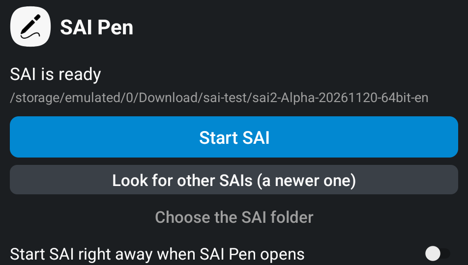

</details>

## FAQ

Questions people asked on Reddit. Tap one to open it.

### Licence and SAI versions

<details>
<summary><b>SAI says my licence certificate is wrong. Do I have to buy SAI again?</b></summary>

No. A certificate is made for one System ID, and SAI on the device has its own, so the `.slc`
from your PC does not work here. Make a new one for the device's System ID with the licence you
already have, for free: [Your SAI licence](#your-sai-licence).

</details>

<details>
<summary><b>SAI crashes or doesn't start (for example after adding the licence)</b></summary>

Check which SAI you have: its title bar shows it, like *PaintTool SAI Ver.2 (64bit)
Alpha.2026.10.19*.

- **32bit SAI:** use the **64bit** one. 32bit Windows programs are much harder to run on an
  Android device, and a user reported that the 32bit SAI didn't start properly.
- **A build from before 2026:** use a 2026 build. Older ones start but draw without pressure.

See [SAI versions](#sai-versions).

</details>

<details>
<summary><b>I downloaded a newer SAI, but SAI Pen still opens the old one</b></summary>

SAI Pen remembers the SAI it found first and doesn't look through the device again by itself.
Unzip the new SAI (the whole folder), then on SAI Pen's screen tap **Change SAI…**: it lists
every SAI on the device, newest first, with the one in use marked. Tap the one you want, or
**Choose the folder myself…** at the end of the list. Your brushes, settings and licence stay.

</details>

<details>
<summary><b>How do I get the dark interface?</b></summary>

That's SAI's own setting, but only in the **Alpha** builds: **Window > Window Color > Dark Colors**.

SYSTEMAX's [download page](https://www.systemax.jp/en/sai/devdept.html) has two SAI Ver.2 builds:

- **Technical Preview Stable Version** (2026-07-02b), at the top: the last one before SAI's big
  renovation. It has no dark colours. Its title bar says *Preview.2026.07.02b*.
- **Technical Preview Major Renovated Version**, lower on the page: the newer line, with the dark
  colours. Its file name and title bar say *Alpha*: **Alpha.2026.10.19** and every newer Alpha
  have them. SYSTEMAX notes that files and shortcut keys saved with it don't work in older builds.

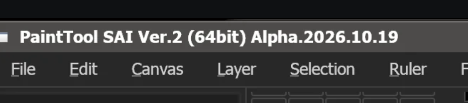


Both work with SAI Pen. Already using the stable one? Download the Alpha (**64bit**), unzip it,
then tap **Change SAI…** on SAI Pen's screen (see the answer above).

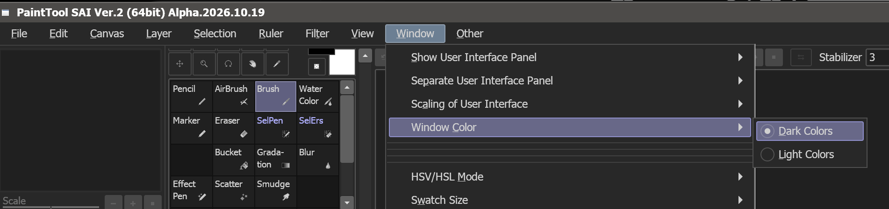

</details>

### Drawings and files

<details>
<summary><b>SAI says it saved my drawing, but I can't find it on my device</b></summary>

It is probably on `C:\`, which only exists inside the app. Save it again with **File > Save As**
on drive **`F:\`**: it shows up in **My Files** (or **Files**) under **Documents/SAI Drawings**.

SAI Pen also copies drawings it finds in `C:\users\xuser` (and its Desktop, Documents and
Pictures) to **Documents/SAI Drawings** when you close SAI. More in
[Where your drawings are](#where-your-drawings-are--how-drives-work).

</details>

<details>
<summary><b>How do I export a PNG, or share a drawing?</b></summary>

**File > Save As**, choose `.png` or `.jpg` as the file type and save on drive **`F:\`**. Pictures show up in the
device's **Gallery** app (album *SAI Drawings*), and you can share them from there or from
**My Files**. SAI's own `.sai2` files don't show in the Gallery, only in My Files.

</details>

<details>
<summary><b>How do I open a picture from my Gallery in SAI?</b></summary>

Drive **`G:\`** is your gallery (since 0.4.31): the device's `DCIM` (camera, screenshots) and
`Pictures` folders in one place. Drive **`E:\`** is your whole device, for pictures in any other
folder. Or copy the picture into Documents/SAI Drawings and open it from `F:\`.

</details>

<details>
<summary><b>Are my drawings, brushes and licence safe when I update or uninstall?</b></summary>

- **Updating:** install the new APK over the old one. Everything stays.
- **Uninstalling** deletes everything inside the app: drawings on `C:\` and the installed licence.
  Drawings on `F:\`, your brushes and the `.slc` in Downloads stay.

<details>
<summary>Updating from 0.4.22 or older?</summary>

Before 0.4.23, drawings saved in SAI's own folders (`C:\users\xuser`, its Desktop, Documents or
Pictures) stay inside the app. Installing the new APK over the old one keeps them, and the first
start of 0.4.23 or newer moves them to **Documents/SAI Drawings**. But if the update fails and you
uninstall the app to get it in, they are gone. So first open SAI, save each drawing into the
"SAI Drawings" folder, and check in the Files app that they are there.

</details>

</details>

### Using SAI

<details>
<summary><b>SAI forgot my new tools or settings after I closed it</b></summary>

Close SAI with its own red **✕** in the top right corner (or **File > Exit**). SAI saves its
settings only when it closes itself: new tools you added, brushes, the panel layout, the window
size. If you close SAI Pen instead (swiping it away in the recent apps, for example), everything
you changed in SAI since it started is gone. Your drawings are not affected by this, as long as
you saved them.

Since 0.4.33 SAI opens full screen every time, whatever size it remembered.

</details>

<details>
<summary><b>One tap with the pen counts as several clicks</b></summary>

Check SAI's pen setting: in SAI open **Options** and look at **Pen Tablet Control API**. It should
be **Use WinTab API**. With **Use WinTab API with Ver.1 Compatible Method** one tap can count as
several clicks (found by a user, thank you!). Change it back to **Use WinTab API**, then restart
SAI.

</details>

<details>
<summary><b>SAI in Japanese, or Japanese text shows as boxes or garbled</b></summary>

SAI Pen's screen has **Language** (since 0.4.33):

- **SAI's menus:** in Japanese on a device set to Japanese, in English on any other, by default.
  You can pick **English** or **日本語** yourself. SAI's menus only come in these two languages.
- **Font for Japanese, Chinese and Korean text** (layer names, file names, the Japanese menus):
  pick one of the fonts that come with Android, such as Noto Sans CJK. SAI Pen only points SAI
  at fonts already on your device: no font is included, copied or downloaded.

A change takes effect the next time SAI starts.

**SAI's Text tool** has its own font engine, so this setting does not change it. With SAI
**Alpha.2026.11.20** or newer the Text tool shows letters (that SAI build added support for CFF
fonts, the kind Android has); with older builds text typed with it shows as empty squares. With
Alpha.2026.11.20 SAI may also show "An exception error has occurred" in the bottom right corner
once the Text tool is picked, and at every start while it stays picked. SAI keeps working
(seen by the author on a Galaxy Tab S6 Lite).

Tested by a user on a device set to Japanese: SAI opened in Japanese and
[everything showed correctly](https://www.reddit.com/r/PaintToolSAI/comments/1y0k3bk/comment/19t4oinyuuqkh/). Thank you!

You don't need Winlator's own steps for Japanese.

</details>

<details>
<summary><b>SAI restarts or forgets my brushes, layout or bookmarks when I switch apps</b></summary>

Android closes apps in the background when the device runs low on memory, and SAI only saves its
settings when it is closed properly. What helps:

- **Background protection** keeps SAI open. It is on by default since 0.4.27. To check:
  close SAI, scroll to the bottom of SAI Pen's screen, tap **Winlator settings**, then ☰ >
  **Settings** > **System** > **Enable Background Protection**, and tap the blue **✓** to save.
- **Still closes now and then?** Right under it is **Enable wakelock when the device is locked**:
  try it on, then off, and see what works better on your device. When SAI starts, Android may ask
  about notifications: tap **Allow**, the protection runs through a notification.
- Settings > Apps > SAI Pen > **Battery**: **Unrestricted**. Take SAI Pen off the **Sleeping apps**
  lists.
- After setting up your brushes, press SAI's **save tool settings** button, or close SAI once with
  **File > Exit**.

On some phones (seen on a Galaxy S26 Ultra) SAI can still restart. On Samsung tablets it stays
open.

</details>

<details>
<summary><b>How do I open the keyboard, to type a file name or a canvas size?</b></summary>

1. In SAI, tap the box you want to type in (the file name, the width, the height).
2. **Tap the screen with three fingers at once.** The tablet's keyboard opens.
3. Type. To close the keyboard, use Android's **Back** gesture or button.

If three fingers don't work, **tap with four fingers** and choose **Keyboard** in the menu on the
left. The keyboard can cover a lot of the screen, on phones most of all.

</details>

<details>
<summary><b>How do I right-click?</b></summary>

**Tap the screen with two fingers at once**, quickly and without moving them (moving two fingers
scrolls the canvas). Or press the pen's side button. The right click goes where the cursor is.

</details>

<details>
<summary><b>Zooming with two fingers works badly or not at all</b></summary>

Check [palm rejection](#palm-rejection) on SAI Pen's screen: turn off **Ignore fingers while the
pen is near, and 1.5 s after**. While the pen hovers over the glass, and for 1.5 s after a stroke,
it ignores every finger, so a pinch right after drawing, with the pen still in your hand, often
doesn't zoom at all.

What works best for me is the other two on and this one off:

- **Ignore touches Android marks as a palm**: on
- **Ignore large touches, like the side of a hand**: on
- **Ignore fingers while the pen is near, and 1.5 s after**: off

I don't recommend that third one: it's an extra check that makes zooming, scrolling and turning
the canvas harder. Turn it on only if your palm still clicks or moves the cursor with the other
two on.

</details>

<details>
<summary><b>What's in the menu that opens with four fingers?</b></summary>

**Tap the screen with four fingers at once** and a menu slides in from the left:

- **SAI Pen: licence and settings** closes SAI and opens SAI Pen's screen. Save your drawing
  first: unsaved work is lost.
- **Keyboard** opens the tablet's keyboard, the same as a three-finger tap.
- **Toggle Fullscreen**, **Magnifier** and **Exit** (closes SAI), and a few more of Winlator's own
  tools, such as **Task Manager** and **Logs**.

Tap outside the menu, or swipe it back to the left, to close it.

</details>

<details>
<summary><b>What can I change in "Winlator settings"?</b></summary>

SAI Pen is built on Winlator, and some of Winlator's own settings are still there. Close SAI first
(**File > Exit**), then:

1. On SAI Pen's screen, scroll all the way down and tap **Winlator settings**.
2. Tap **☰** at the top left, then **Settings**.
3. Change what you need, then tap the blue **✓** at the bottom right to save.

What's useful there for SAI:

| Setting | What it does |
|---|---|
| **Cursor Speed**, **Cursor Size**, **Color** | how the mouse cursor looks and moves |
| **Move Cursor to Touchpoint** | a finger puts the cursor under itself (on by default in SAI Pen) |
| **Capture pointer on external mouse** | for a mouse connected to the tablet |
| **Enable Background Protection** | keeps SAI open when you switch apps (on by default in new versions) |
| **Enable wakelock when the device is locked** | keeps SAI running while the screen is off |
| **Box64 Preset** | how SAI's Windows code is run; leave it as it is unless something is slow or breaks |

Everything else there (containers, shortcuts, Wine and Box64 versions, game controllers) SAI Pen
sets up by itself: better not to change it. SAI Pen's own settings (screen sharpness, palm
rejection, timelapse) are on SAI Pen's screen, not here.

</details>

<details>
<summary><b>Can I use Ctrl, Alt and shortcuts? (Transform, perspective rulers…)</b></summary>

- **Commands** like Transform, Undo or Save are also in SAI's menus at the top, so you can tap
  them there without a keyboard.
- **Some things need a key held down while you use the pen.** For example, to adjust a
  **perspective ruler** in SAI you hold **Ctrl** or **Alt** while you drag its handles (to move or
  turn the horizon). The tablet's own keyboard can't hold Ctrl or Alt.
- **Since 0.4.28: [on-screen keys](#on-screen-keys-ctrl-ctrlz-ctrlt).** A small button over SAI
  opens Ctrl to hold and shortcuts like Ctrl+Z, Ctrl+T or Enter, each one tap. You choose them
  yourself on SAI Pen's screen.
- **A Bluetooth keyboard** works much better: since 0.4.24 every shortcut works, with Shift too,
  and since 0.4.27 Tab and Shift+Tab.

</details>

<details>
<summary><b>Why is there lag, and how do I reduce it?</b></summary>

**Why.** SAI is a Windows program for PC processors, and your device has a different kind of
processor (ARM). So SAI Pen runs it through Wine, which stands in for Windows, and Box64, which
translates SAI's code for your processor while it runs. On top of that, every picture SAI draws
goes through a virtual screen before it reaches yours. Each step costs a little time, so a
stroke can't feel as instant as on a PC. How much you notice depends on the device: a newer,
faster processor and more RAM lag less.

**How to reduce it.** Some things you can try:

- **Since 0.4.35:** SAI sees only the device's fast cores (*Settings > Processors SAI sees*), set
  by itself. Keep it on the recommended number, and keep **Drawing** under *Fast processor cores*.
  More in the tip [at the top](#sai-pen-for-android-painttool-sai-with-s-pen-pressure).
- **Since 0.4.29:** try **Screen drawing** on SAI Pen's screen: **Front buffer** or **Front buffer
  while drawing**. SAI's picture then goes straight onto the screen instead of waiting in Android's
  queue, so the ink comes sooner. If the picture flickers, jumps or tears on your device, go back to
  **Standard** (the default since 0.4.30). The same if bits of the brush circle stay on the screen
  while the pen hovers (with a big brush, pieces of the old circles are left around the new one):
  on a Galaxy Tab S6 Lite this showed only with the front buffer, and **Standard** made it go away.
- Open **Ready to draw** above **Start SAI**: it shows what may slow SAI down right now (memory,
  battery saver, heat, storage) and what helps.
- Lower **SAI's screen sharpness** on SAI Pen's screen before you tap **Start SAI**. Fewer pixels
  to draw means faster strokes. If everything gets too big, change **Window > Scaling of User
  Interface** in SAI.
- Use a smaller canvas with fewer layers.
- Close other apps before drawing, so that SAI has more RAM.
- Use lighter brushes. The ones with texture or blending are the heaviest, and the plain round
  brush is the lightest (see the next question).

If one thing lags much more than the rest, like a certain brush or zooming, please say which in
[Reporting a problem](#reporting-a-problem).

</details>

<details>
<summary><b>Some brushes lag on fast strokes</b></summary>

Brushes with a shape (like Acrylic) make SAI itself do much more work for every stroke than the
round one: about twice the processor and the ink comes later. It is SAI's own brush drawing, not
something SAI Pen adds. The round brush, smudge, transform and lasso fill don't lag.

</details>

<details>
<summary><b>Can I bring my brushes and presets from my PC?</b></summary>

Yes: zip SAI's `settings` folder on the PC and add it on SAI Pen's screen. Step by step in
[Bring your tools and presets from a PC](#bring-your-tools-and-presets-from-a-pc).

</details>

### Devices and installing

<details>
<summary><b>Will it work on my tablet or pen?</b></summary>

Made and tested for the **Samsung S Pen**. Users also run it on Xiaomi, Huawei, Wacom and Ugee
devices ([Tested on](#tested-on)). Any pen that gives Android its pressure should work: you can
[check a pen in a minute](#check-a-pen-in-a-minute-without-sai), even in a shop. Passive styluses
(rubber or disc tips) have no pressure. More in [Which devices and pens](#which-devices-and-pens).

</details>

<details>
<summary><b>Which device should I use so that SAI doesn't lag?</b></summary>

This is a rough guide, not a benchmark. It comes mostly from how SAI Pen works, plus a few
reports from a small number of people ([Tested on](#tested-on)), so take it as a best guess.

**What matters most is the processor**, and especially how fast one core is. SAI's code is
translated for your processor while it runs (see
[Why is there lag](#why-is-there-lag-and-how-do-i-reduce-it)), and SAI draws a stroke mostly on
one core, so one fast core helps more than many slow ones. **RAM comes second:** with too little,
Android squeezes SAI and it stutters now and then. 4 GB works but stutters, 6 GB is fine for small
canvases, **8 GB or more is comfortable**, 12 GB for big canvases with many layers. The graphics
chip matters very little.

| Level | Processors | Devices, for example | What it's like |
|---|---|---|---|
| **Great** | Snapdragon 8 Gen 2 / 8 Gen 3 / 8 Elite and newer, Dimensity 9300 / 9400 | Galaxy S26 Ultra ✓, Galaxy S25 Ultra ✓, Galaxy Tab S9 / S9+ / S9 Ultra (not FE), Galaxy Tab S10+ / S10 Ultra, Galaxy Tab S11, OnePlus Pad 2 | S26 Ultra: everything is fast |
| **Good, a little lag on heavy brushes** | Snapdragon 8 Gen 1, 8s Gen 3, 870 | Galaxy Tab S8 / S8+ / S8 Ultra ✓, Xiaomi Pad 7 Pro ✓, Xiaomi Pad 6 ✓, Wacom MovinkPad Pro 14 ✓ | works, a slight lag |
| **Medium, heavy brushes lag** | Exynos 1380 / 1580, Snapdragon 7 series | Galaxy Tab S9 FE / FE+ ✓, Galaxy Tab S10 FE / FE+, Xiaomi Pad 7 (not Pro), Huawei MatePad 11.5 PaperMatte ✓ | the round brush is fine, shaped brushes lag on fast strokes |
| **Slow** | Snapdragon 720G and slower, Helio, Unisoc | Galaxy Tab S6 Lite ✓, Ugee UT2 ✓ (Helio G99), budget tablets like the Galaxy Tab A | works, but slows down now and then, more on big canvases and with 4 GB |

✓ means someone has run SAI Pen on it. The others are placed only by their processor. Whichever device
you use, it needs a pen with pressure: [check a pen in a minute](#check-a-pen-in-a-minute-without-sai).

</details>

<details>
<summary><b>Why does SAI take so long to start?</b></summary>

How long SAI takes to open depends mostly on the processor. Measured from tapping **Start SAI**
until SAI is open:

| Device | Processor | Fastest core | SAI starts in |
|---|---|---|---|
| Galaxy S24 Ultra | Snapdragon 8 Gen 3 | Cortex-X4, 3.4 GHz | about 5 s |
| Galaxy Tab S6 Lite (2022) | Snapdragon 720G | Cortex-A76, 2.3 GHz (2 fast + 6 slow cores) | about 21 s |

Why it takes so long (our best understanding, not measured step by step yet):

- **Almost all of the start runs on one core at a time.** Wine (the layer that runs Windows
  programs) starts its parts one after another, each waiting for the one before. That's why the
  speed of one core matters, not how many cores there are.
- **SAI's code is translated on every start.** SAI and Wine are made for PC processors (x86), and
  Box64 translates their code for your phone's or tablet's processor (ARM) while they run. Nothing
  is kept between starts, so this happens again every time, and it is heavy work for a slow core.
- **Storage and RAM.** At the start Wine reads hundreds of megabytes of files. Cheaper tablets have
  slower storage (eMMC instead of UFS) and less RAM, so this takes longer too.

**To guess how fast SAI will start on your device**, look up its processor's single-core score,
for example in Geekbench 6: the Snapdragon 8 Gen 3 scores about 2200, the Snapdragon 720G about 550,
about 4 times less, close to 5 s vs 21 s. A processor with half the S24 Ultra's single-core score
will likely start SAI in about 10 s. Only a rough guide: storage, RAM and what else is running
change it a bit. The same single-core speed also decides how smoothly you draw: see
[Which device should I use](#which-device-should-i-use-so-that-sai-doesnt-lag).

</details>

<details>
<summary><b>The APK won't install</b></summary>

Android only installs apps from outside the Play Store after you allow it: it asks once for your
browser or file manager (Settings > Apps > Special access > **Install unknown apps**). Download
only `SAI-Pen-<version>.apk`, not the `sources.tar`. SAI Pen is not in Google Play: every version
is a [GitHub release](https://github.com/ametrien/Paint-Tool-SAI-pen-pressure-Android/releases).

</details>

<details>
<summary><b>iPad? Mac? Linux?</b></summary>

- **Mac:** yes, [SAI Pen Pressure for macOS](https://github.com/ametrien/Paint-Tool-SAI-pen-pressure-macOS-fix).
- **iPad:** sadly no. iPad apps may not make code while they run (JIT), and a Windows program
  needs that to run fast enough for painting on an ARM chip. Outside the App Store everyone would
  have to sign the app themselves, again every 7 days with a free Apple ID.
- **Linux:** not this project.

</details>

<details>
<summary><b>Does SAI Pen send anything anywhere?</b></summary>

No. Nothing leaves the device: SAI Pen never sends your files or your licence anywhere.

</details>

## Where your drawings are & how drives work

SAI runs inside the app with Wine, which gives it drive letters for folders on your device:

| Drive in SAI | On your device | What it is for |
|---|---|---|
| **`F:\`** | **Documents/SAI Drawings** | **Your drawings.** Safe, and stays when you uninstall the app. |
| **`E:\`** | your whole device | Any folder, such as `E:\Pictures`, `E:\DCIM` or `E:\Art` |
| **`G:\`** | your gallery (`DCIM` and `Pictures`) | Photos and screenshots to open as references |
| **`H:\`**, **`I:\`**, … | SD cards and USB drives | Each one plugged in when SAI starts. Opening works, but on most tablets Android doesn't let SAI save there: save to `F:\` and copy the file over |
| **`D:\`** | Download | Works, but clearing Downloads could delete your drawings |
| **`S:\`** | SAI's own folder (`sai2.exe`) | |
| **`C:\`** | only inside the app | **Don't save here**: your file manager can't see it, and uninstalling deletes it |

- `.png` and `.jpg` pictures and your timelapse videos show up in the **Gallery** (albums *SAI
  Drawings* and *Timelapses*). `.sai2` and `.sai` files are in **My Files** (or **Files**) only.
- **Open a drawing** from `F:\`, from SAI's **Recent** list, or tap **Open Documents/SAI Drawings**
  on SAI Pen's screen.

<details>
<summary><b>Saved on <code>C:\</code> or the Desktop by mistake?</b></summary>

SAI's save window opens in `C:\users\xuser`, so it's easy to save there. SAI Pen protects you:

1. When you close SAI (or before SAI starts next time), SAI Pen **copies** your drawings
   (`.sai2`, `.sai`, `.psd`, `.png`, `.jpg` and more) from `C:\users\xuser` and its Desktop,
   Documents and Pictures into **Documents/SAI Drawings**.
2. **The original stays on `C:\`**, so SAI's **Recent** list still opens it.
3. **Nothing is overwritten:** if the name is taken, the copy is called `name (2).sai2`. If copying
   fails, nothing is deleted.

</details>

<details>
<summary>More: the linked folders inside <code>C:\</code>, and screenshots</summary>

| In SAI | On your device |
|---|---|
| `C:\users\xuser\SAI Drawings` | Documents/SAI Drawings, the same as `F:\` |
| `C:\users\xuser\Documents\SYSTEMAX Software Development\SAIv2\settings` | Documents/SYSTEMAX Software Development/SAIv2/settings: your brushes, textures and presets |

In SAI's Save As window, choose **`F:\`** from the drive list:


That is the same folder you see in Android's file manager at **Documents/SAI Drawings**:

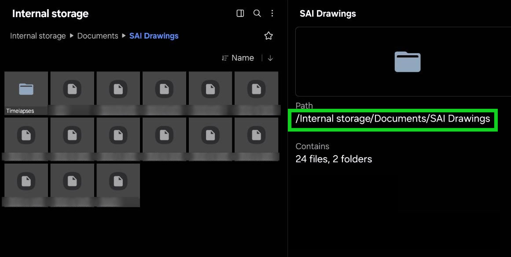

</details>

## Gestures and keyboard

| Gesture | Does |
|---|---|
| S Pen on the glass | draws, with pressure; the side button gives a right click |
| One finger | puts the cursor under itself and clicks |
| Two-finger tap | right click |
| Two fingers, moving | scroll the canvas in any direction |
| Two fingers, pinch | zoom |
| Two fingers, turning | rotate the canvas |
| Three-finger tap | opens the keyboard |
| Three fingers held still for a moment | show or hide the [on-screen keys](#on-screen-keys-ctrl-ctrlz-ctrlt) (0.4.28) |
| Four-finger tap | the menu (keyboard, close SAI, settings) |
| Four fingers held still for a moment | the gesture settings, right over SAI (0.4.32) |

**Change what a gesture does** (since 0.4.32): **Gestures** on SAI Pen's screen, or hold four
fingers still over SAI. The taps above, the pen's side button (touching or in the air) and its
eraser end can each be a click, the keyboard, the on-screen keys, the menu or a key such as Ctrl+Z.
A few more are free to set: two- and three-finger double taps, one finger held still, and a swipe
in from the left or right edge. Only the four-finger tap and the two-finger scroll, zoom and rotate
stay as they are.

A **Bluetooth keyboard** works for all of SAI's shortcuts (see the [FAQ](#faq)).

### Bluetooth S Pen: undo and redo from the air

**Since 0.4.36.** If your S Pen has Bluetooth (Samsung's S Pen settings show **Air actions**:
Galaxy Note 9 to 20, S22 to S24 Ultra, most Tab S6 to S10 tablets; not the S25 and S26 Ultra or
the Lite and FE tablets), its button works with the pen held **away from the screen**:

| Button, pen away from the screen | Does |
|---|---|
| One press | undo (Ctrl+Z) |
| Two presses | redo (Ctrl+Y) |

Samsung turns this off for every new app, so turn it on once: **Settings → Advanced features →
S Pen → Air actions**, scroll down to **App actions**, tap **SAI Pen** under *Turned off* and turn
its switch on. You can change what each press does in the same place.

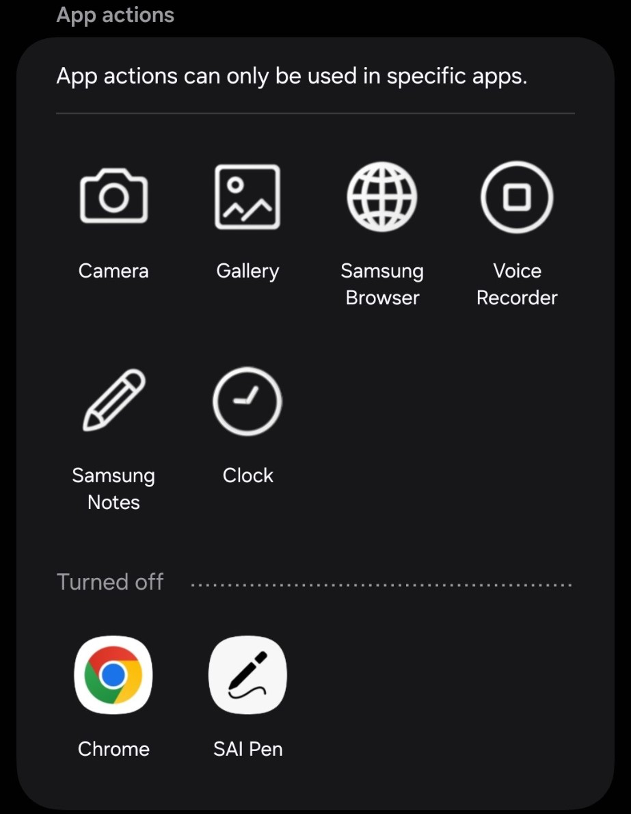
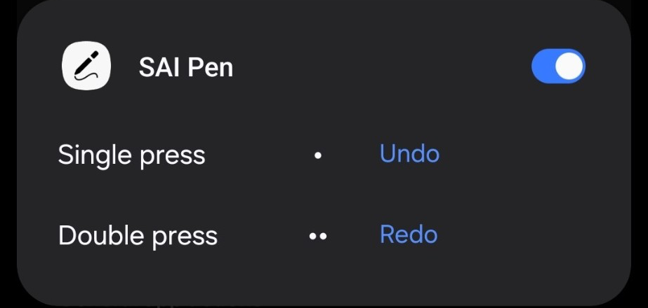

Then SAI Pen is with the apps that are on:

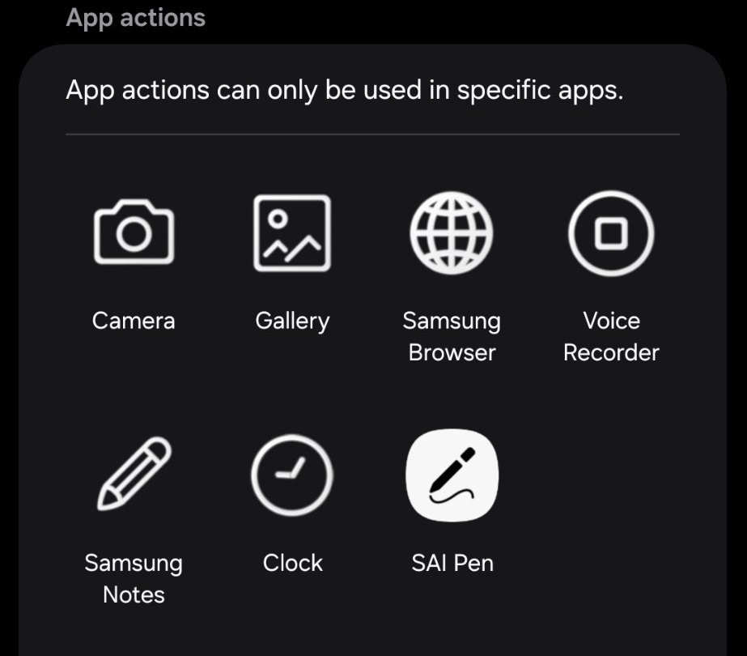

Hold the pen **far enough from the screen** that the cursor no longer follows it. Near the screen
the pen hovers, and the button does what is set under **Gestures** (a right click as standard).

## On-screen keys: Ctrl, Ctrl+Z, Ctrl+T…

**Since 0.4.28.** For SAI without a keyboard: a small **Ctrl** button floats over SAI. Drag it
anywhere, and tap it to open your keys:

| Button | A tap |
|---|---|
| **Ctrl** (held) | keeps Ctrl down (lit) while you use the pen, until you tap it again. Or keep a finger on it. For a perspective ruler's handles |
| **Ctrl+Z**, **Ctrl+Y** | undo, redo |
| **Ctrl+T** | Transform |
| **Ctrl+A**, **Ctrl+D** | select all, deselect |
| **Ctrl+U** | Hue and Saturation |
| **Enter** | finishes a transform |

- **Move** the open buttons by the **⋮** on the left, **close** them with **×**.
- **Hide** them: press and hold the small button, or hold **three fingers still** on the screen for
  a moment. The same three fingers bring them back.
- **Make them your own** on SAI Pen's screen, under **On-screen keys**: up to 8 buttons, each
  *Once* (a tap presses it once) or *Held* (a tap keeps it down until the next tap), any of Ctrl,
  Alt, Shift with a letter, a number, F1–F12, Enter, Space and more. Also the colour, and
  switches to turn the button and the three-finger gesture off.

## Palm rejection

**Always on, nothing to set:** a hand resting on the glass never interrupts a stroke. While the pen
draws, a palm or finger that lands is ignored.

If your palm moves the cursor or clicks while the pen is **not** drawing, turn on the extra checks
on SAI Pen's screen under **Palm rejection**, before starting SAI. Each works on its own:

- **Ignore touches Android marks as a palm.** Uses the device's own palm detection.
- **Ignore fingers while the pen is near, and 1.5 s after.** Gestures still work once the pen is away,
  but zooming right after a stroke gets harder: I keep this one off (see the [FAQ](#faq)).
- **Ignore large touches, like the side of a hand.**

<details>
<summary>Screenshot</summary>


</details>

## Timelapse

> **Experimental.** Up to 0.4.30 the timelapse could lose frames in long drawings and mix two
> drawings in one video; 0.4.31 fixes both. It is still new, so please save your drawings in SAI
> as usual and don't rely on the timelapse as the only record of your work.

> [!WARNING]
> **Tested with one open canvas only.** In 0.5.0 and earlier, having a second document open in
> SAI, for example a reference picture opened next to your drawing, can break the timelapse:
> it may record the other document instead and save almost nothing of your drawing, even if
> you switch back to it. Until this is fixed, paste references into a layer of your drawing,
> or keep Android's screen recorder running as a backup.

**Record a timelapse** on SAI Pen's screen is on from the start. When the pen rests after a
stroke, the app saves a frame of the canvas view you drew in, exactly as it looks on the screen.
Later, **Make a timelapse video** turns the frames into an MP4 in
**Documents/SAI Drawings/Timelapses**, also in the **Gallery** as the *Timelapses* album.

Since 0.4.31 there is **one video per drawing**: when you open a drawing again, even after
closing SAI, its new session is added to the same video. If SAI Pen is not sure a session
continues a drawing, it asks. **My timelapses** on SAI Pen's screen shows a card for each
drawing: tap it to play the video, hold it to delete the timelapse (the drawing itself stays).
Videos made before 0.4.31 stay in the folder.

<details>
<summary>More: a flat video of the whole canvas, speed, and how it works</summary>

- **A flat video of the whole canvas:** open **View > New Floating View**, fit it to its window
  (**Ctrl+0**) and draw in it: the timelapse records that view. You get one video per view.
- **Speed:** frames are taken between strokes. On the Galaxy Tab S6 Lite, drawing with recording
  on was about as fast as with it off.
- The timelapse only records what SAI shows on the screen: it never reads SAI's memory or code.
  How it works, and how that fits SAI's licence:
  [TIMELAPSE-AND-SAI-LICENCE.md](TIMELAPSE-AND-SAI-LICENCE.md).
- The idea comes from [art-timelapse](https://github.com/cromachina/art-timelapse) by cromachina,
  the timelapse tool for SAI on Windows and Linux (see [Licences](#licences)).

</details>

## Your brushes, textures and presets

SAI keeps brushes, textures, tools and presets in
**Documents/SYSTEMAX Software Development/SAIv2/settings** on the device, the same place as on
Windows. They stay when you uninstall SAI Pen. SAI Pen's screen shows what SAI has and has two
buttons for it: **Add brushes or textures** and **Open the folder**.

### Add a brush pack, step by step

1. **Get the pack's `.zip` onto the device:** download it there, or send it from a computer (USB
   cable, Google Drive, Quick Share, email, a messenger).
2. **Open SAI Pen** (close SAI first) and scroll down to the line that starts with **In SAI:**.
3. **Tap Add brushes or textures** and pick the `.zip` (loose `.bmp` pictures work too).
4. **Check what SAI Pen found and tap Add.** It sorts the pictures into SAI's folders. Pictures
   SAI already has stay as they are, and only `.bmp` and `.ini` files are taken, never a program.
5. **Start SAI** and pick them:

   | What you added | Where you pick it in SAI |
   |---|---|
   | Brush textures | choose a brush, then the **[ No Texture ]** list in its settings |
   | Brush shapes | choose a brush, then the **[ Simple Circle ]** list in its settings |
   | Paper textures | Layer Effect, **Paper** |
   | Scatter shapes | the **Scatter** tool |

<details>
<summary>Screenshots of the steps</summary>

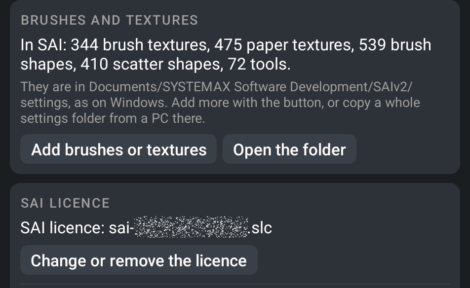

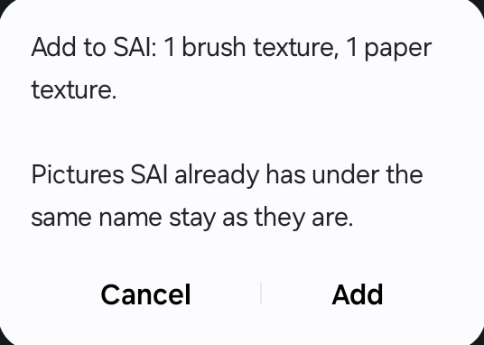

Pictures that are not in folders named like SAI's (`brushtex`, `papertex`, `scatter`, `blotmap`,
`bristle`, `brshape`) get a question first: are they brush textures, paper textures, brush shapes
or scatter shapes? The pack's description usually says.

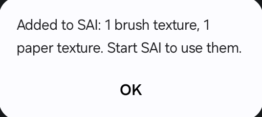

</details>

### Choose which ones SAI lists

**Since 0.4.37.** A big collection makes SAI's texture and shape lists thousands long. Keep only
the ones you use:

1. On SAI Pen's screen, in **Brushes and textures**, tap **Brush textures**, **Paper textures**,
   **Brush shapes** or **Scatter shapes**. The browser opens on that kind.
2. Tap **Select** (or hold a picture), then tap the ones to put away. **All** picks every one shown,
   so search first to pick, say, all the chalks; **None** clears the picks.
3. Tap **Hide from SAI**. Start SAI again and they are gone from its lists.

**Hidden** next to **In SAI** lists the hidden ones: select them and tap **Show in SAI** to bring
them back. A picture's own page has the same button. If one of your tools uses a texture or shape
you hide, SAI Pen says which tools first.

Nothing is deleted: hidden pictures move, with their `.ini`, to
**Documents/SYSTEMAX Software Development/SAIv2/hidden-from-sai**, next to `settings`, where SAI
doesn't look. Adding the same pack again doesn't bring them back. Some packs put the same pictures
in several kinds (brush textures, paper and brush shapes): hide them in each kind you don't want
them in.

### Bring your tools and presets from a PC

1. On the PC, in File Explorer open **Documents > SYSTEMAX Software Development > SAIv2**,
   right-click `settings` and choose **Send to > Compressed (zipped) folder**.
2. Send `settings.zip` to the device.
3. On SAI Pen's screen tap **Add brushes or textures**, pick `settings.zip` and tap **Replace**.
   The device's old settings are kept beside it as `settings-before-` and the date.
4. Start SAI. It opens full screen, even though the PC's window size came along.

<details>
<summary>More: by hand, and what was tested</summary>

**By hand.** **Open the folder** on SAI Pen's screen opens it in the Files app. A pack's `.bmp`
and `.ini` files go into the folders of the same name in `settings` (`blotmap`, `bristle` and
`brshape` are in `brushfom`), and a PC's `settings` folder goes in place of the one there.
Replace that one as a whole rather than mixing two: SAI numbers its tools, so two sets can mix up
the tool panel. New files show up in SAI after it starts again.

**Tested** on a Galaxy Tab S6 Lite with a settings folder from another computer (its tools, brush
values and window came along) and with the
[Brush Collection](https://www.reddit.com/r/PaintToolSAI/comments/1qb1dix/brush_collection_updated/)
from r/PaintToolSAI: all 2,195 textures and brush shapes (611 MB) show up in SAI, and SAI is ready
in about 8 seconds, as without them. The collection's `SaiBristleCorrector.exe` is a Windows
program and is not needed.

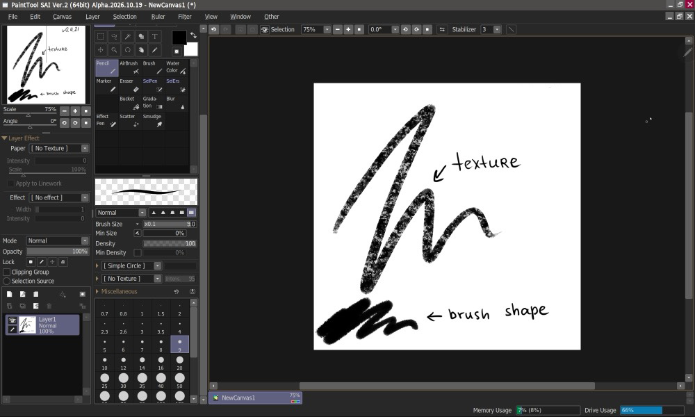

The first start of 0.4.21 moved the settings SAI already had inside the app to that folder. If you
had put a `settings` folder there first, yours is used, and the one from inside the app is kept
inside the app as a backup.

</details>

## Your SAI licence

Without a licence certificate SAI Ver.2 does not save or open files. A certificate is made for
one System ID, and SAI on the device has its own, so the `.slc` from your PC does not work here.
A new certificate for the device's System ID is all it takes, with the licence you already have:

1. Start SAI on the device and open **Other > System ID**. Note the System ID it shows.

   

   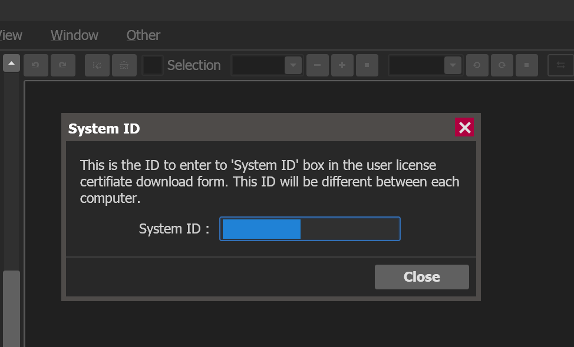

2. Find the email SYSTEMAX sent when you bought SAI: it has your **licence number** and
   **password**.
3. On <https://www.systemax.jp/en/license.html> enter the licence number, the password and the
   device's System ID, and download the certificate (`sai-....slc`).
4. Put it in **Downloads** on the device, tap **Add a SAI licence** on SAI Pen's screen and then
   **Look for it**, or **Choose the file** wherever it is.

<details>
<summary>More: a new System ID, the hidden number, updates</summary>

- Once you have said yes to a found licence, a newer `sai*.slc` that later lands in Downloads (a
  new System ID, say) is taken by itself at the next start.
- On SAI Pen's screen the licence number is hidden under a spoiler, so a screenshot of the screen
  does not show it. Tap it to see the number.
- Updating SAI Pen keeps the installed certificate. Uninstalling the app removes it together with
  Wine; the copy in Downloads stays, and **Look for it** finds it again.

</details>

## Which devices and pens

- **Android 8 or newer** on a **64-bit ARM processor** (almost every tablet and phone of recent
  years). SAI runs through Wine and Box64, so a faster device draws more smoothly.
- **Made for the Samsung S Pen:** Galaxy Tab S, Tab S FE and Tab S Lite tablets, Galaxy S Ultra
  phones (S22 Ultra and newer) and Galaxy Note phones (Note 8 and newer).
- **Other pens should work in theory** if they give Android their pressure: the app uses only
  Android's own pen events. Expect some problems: I only have Samsung devices, so I can't easily
  fix problems that show up only on other ones.
- **Will not work: passive styluses** (rubber, mesh or clear disc tips, or an "active" stylus that
  is never paired with the device). Android sees them as a finger, with no pressure.

<details>
<summary>More: pens without hover, other pens to try</summary>

**Not tested, but should work in theory:** active pens of other tablets (Lenovo Tab Pen and
Precision Pen, OnePlus Stylo, Honor and Huawei pens), USI 2.0 pens on tablets that support them, a
Wacom pen tablet plugged into the Android device by USB.

**Pens without hover.** Some pens, like the Ugee UT2's, tell Android nothing until they touch the
glass. Up to 0.4.19 this made SAI take the first touch of a stroke for a mouse click and leave a
dot at the full brush size. 0.4.20 fixes this (confirmed on the Ugee UT2). With such a pen the
cursor shows only while the pen touches, the side button may be taken by the maker for its own
shortcut (then there is no right click), and an eraser end draws like the tip.

</details>

### Check a pen in a minute, without SAI

This works on any Android device, even one in a shop:

1. Turn on **Developer options**: in Settings, open **About phone** (or About tablet; on Samsung
   then **Software information**) and tap **Build number** seven times.
2. In **Settings > Developer options**, turn on **Pointer location**.
3. Draw with the pen and watch the **`Prs`** number in the bar at the top. If it changes with how
   hard you press, the pen has pressure and SAI Pen can pass it to SAI.
4. Hold the pen just above the screen. If a crosshair follows it, the pen has **hover** and SAI
   shows its brush circle before you touch.

Turn Pointer location off again afterwards. If you try a device that is not in the table below,
please tell me on [Reddit](https://www.reddit.com/r/PaintToolSAI/comments/1y0k3bk/i_made_sai_2_work_on_android_with_pen_pressure/)
how it went.

## Tested on

- **Huawei:** MatePad 11.5 PaperMatte, MatePad 11.5 S
- **Huion:** Kamvas Slate 11
- **Samsung:** Galaxy Tab S6 Lite, Galaxy S26 Ultra, Galaxy Tab S9 FE+, Galaxy Tab S8, Galaxy Tab S8 Ultra, Galaxy S25 Ultra (?)
- **Ugee:** UT2, Triopad UT3
- **Wacom:** MovinkPad 14
- **Xiaomi:** Pad 7 Pro, Pad 6
- **XP-Pen:** Magic Note Pad

SAI draws with pressure on all of them (15 models, sorted by company below).

| Device and pen | Android | SAI build | Result | Reports |
|---|---|---|---|---|
| Huawei MatePad 11.5 PaperMatte |  |  | everything works | [1](https://www.reddit.com/r/PaintToolSAI/comments/1y0k3bk/comment/19sxnbcop9ngk/) |
| Huawei MatePad 11.5 S, Magic Pen Pro (as reported) |  |  | works flawlessly. Asked for a switch so fingers don't draw | [1](https://www.reddit.com/r/EmulationOnAndroid/comments/1rbof71/comment/19t5ko27l3dpd/) |
| Huion Kamvas Slate 11 |  |  | works, with some input lag. SAI Pen found the downloaded SAI by itself | [1](https://www.reddit.com/r/PaintToolSAI/comments/1y0k3bk/comment/19t4pkpibg3cz/) |
| Samsung Galaxy Tab S6 Lite (2022), SM-P613, S Pen | 14 | Alpha.2026.10.19 | pen, pressure, gestures, saving with a licence, timelapse: work. Works but feels a little slow (Snapdragon 720G, 4 GB) | the author's |
| Samsung Galaxy S26 Ultra, S Pen |  | Alpha.2026.10.19 | without a licence: SAI found by itself, starts, the pen draws with pressure. Looks good at sharpness 1080 and 200% scaling | the author's |
| Samsung Galaxy Tab S9 FE+, S Pen |  | Preview.2026.07.02b | works. Sharpness 1600 with SAI's scaling at 150% looks good. Speed log 20 to 24 ms. Shaped brushes lag on fast strokes, the round one doesn't (SAI's own brush drawing is heavier, reproduced). Bluetooth keyboard works since 0.4.24, shortcuts with Shift too. A second user: SAI restarted after switching apps until *Enable Background Protection* was ticked in Winlator settings, then layout and brushes stayed; a 6000 × 6000 canvas and the vector tools run smoothly. Since 0.4.35 (SAI sees only the fast cores) the brushes that used to lag work much better, by one of them | user 1: [1](https://www.reddit.com/r/PaintToolSAI/comments/1y0k3bk/comment/19swod9vn4ohx/), [2](https://www.reddit.com/r/PaintToolSAI/comments/1y0k3bk/comment/19sxiltaa3t38/), [3](https://www.reddit.com/r/PaintToolSAI/comments/1y0k3bk/comment/19sxrc9i8tzb5/); user 2: [1](https://www.reddit.com/r/PaintToolSAI/comments/1y0k3bk/comment/19szjrilnas5d/), [2](https://www.reddit.com/r/PaintToolSAI/comments/1y0k3bk/comment/19t06t824gqv9/) |
| Samsung Galaxy Tab S8, S Pen (Snapdragon 8 Gen 1) |  | 64bit Alpha | works, with a very slight lag. The 32bit SAI crashed after adding the licence | [1](https://www.reddit.com/r/PaintToolSAI/comments/1y0k3bk/comment/19t14tbgwe9kx/), [2](https://www.reddit.com/r/PaintToolSAI/comments/1y0k3bk/comment/19t1papotytqb/) |
| Samsung Galaxy Tab S8 Ultra |  | Preview.2026.07.02b | works | [1](https://www.reddit.com/r/PaintToolSAI/comments/1y0k3bk/comment/19t33xaqqyj9e/) |
| Samsung Galaxy S25 Ultra (?) (a phone; probably the Ultra, the one with an S Pen) |  | 2024 build, then the newest | works. Brush settings stay once saved with SAI's own *save tool settings* button. Drawings found in Documents/SAI Drawings. Bluetooth keyboard works, shortcuts too; the perspective tools need Ctrl, so a keyboard. The APK did not install straight on the phone and was installed from a computer | [1](https://www.reddit.com/r/PaintToolSAI/comments/1y0k3bk/comment/19sx40z5pvegy/), [2](https://www.reddit.com/r/PaintToolSAI/comments/1y0k3bk/comment/19sxoy0rei2o2/), [3](https://www.reddit.com/r/PaintToolSAI/comments/1y0k3bk/comment/19sxxynt6o4qr/) |
| Ugee UT2 |  | Alpha.2026.10.19 | the pen draws with pressure; the pen has no hover. Before 0.4.20 most strokes started with a dot at the full brush size; fixed in 0.4.20, confirmed by the user on the Ugee | [1](https://www.reddit.com/r/PaintToolSAI/comments/1y0k3bk/comment/19sw7m7yipvy9/), [2](https://www.reddit.com/r/PaintToolSAI/comments/1y0k3bk/comment/19swb9t3uq5fm/), [3](https://www.reddit.com/r/PaintToolSAI/comments/1y0k3bk/comment/19sz9ycgcwwed/) |
| Ugee Triopad UT3 |  |  | works | [1](https://www.reddit.com/r/PaintToolSAI/comments/1y0k3bk/comment/19t38feshcxz5/) |
| Wacom MovinkPad 14 |  |  | works great. Tab and Shift+Tab work since 0.4.27 | [1](https://www.reddit.com/r/PaintToolSAI/comments/1y0k3bk/comment/19sxp79n24g04/), [2](https://www.reddit.com/r/PaintToolSAI/comments/1y0k3bk/comment/19sxqydwuxeyt/) |
| Xiaomi Pad 7 Pro, Xiaomi Focus Pen |  | Alpha.2026.10.19 | the pen draws with pressure (2024.11.23 and 2019.08.12: no pressure). Before 0.4.19 the palm sometimes drew stray lines; 0.4.19 added the palm rejection switches. A little lag | [1](https://www.reddit.com/r/EmulationOnAndroid/comments/1rbof71/comment/19sw3614hityb/), [2](https://www.reddit.com/r/EmulationOnAndroid/comments/1rbof71/comment/19sw5lbtctq1v/) |
| Xiaomi Pad 6 (6 GB, 128 GB), Xiaomi Smart Pen 2nd gen | 14 | Alpha.2026.10.19 | the pen draws with pressure, runs quite well (tested less than the Pad 7 Pro) | [1](https://www.reddit.com/r/EmulationOnAndroid/comments/1rbof71/comment/19sw5lbtctq1v/) |
| XP-Pen Magic Note Pad |  |  | works fine | [1](https://www.reddit.com/r/PaintToolSAI/comments/1y0k3bk/comment/19t4vb6r1sohs/) |
| A device set to Japanese (model not reported yet), pen |  | Alpha.2026.11.20 | SAI in Japanese with 0.4.33: menus, panels and text show correctly. One pen tap counted as several clicks while SAI's *Pen Tablet Control API* was on *Use WinTab API with Ver.1 Compatible Method*; *Use WinTab API* fixed it | [1](https://www.reddit.com/r/PaintToolSAI/comments/1y0k3bk/comment/19t4mhaoc2cjo/), [2](https://www.reddit.com/r/PaintToolSAI/comments/1y0k3bk/comment/19t4nrfajyb5u/), [3](https://www.reddit.com/r/PaintToolSAI/comments/1y0k3bk/comment/19t4oinyuuqkh/) |

### SAI versions

SAI's title bar shows which build you have, like *PaintTool SAI Ver.2 (64bit) Alpha.2026.10.19*.
Use the **64bit** SAI.

| SAI Ver.2 (64bit) build | Result | Tested on |
|---|---|---|
| Alpha.2026.11.20 | works, also in Japanese (SAI Pen 0.4.33) | a device set to Japanese (by a user) |
| Alpha.2026.10.19 | works, the pen draws with pressure | Galaxy Tab S6 Lite, Galaxy S26 Ultra, Xiaomi Pad 7 Pro, Xiaomi Pad 6, Ugee UT2 |
| Preview.2026.07.02b | works | Galaxy Tab S9 FE+ (by a user) |
| 2024.11.23 | starts, but draws without pressure | |
| 2019.08.12 | starts, but draws without pressure | |

## Reporting a problem

GitHub issues are closed for now. Please comment on the
[Reddit post](https://www.reddit.com/r/PaintToolSAI/comments/1y0k3bk/i_made_sai_2_work_on_android_with_pen_pressure/)
instead, and check the [FAQ](#faq) first.

**Please give as many details as you can.** I can only fix what I can reproduce, and a short
"it doesn't work" usually isn't enough:

- **Device** and **Android version** (Settings → About tablet / About phone);
- **SAI Pen version** (bottom of SAI Pen's screen) and **SAI version** (SAI's title bar);
- **your pen or keyboard**, if the problem is about them;
- **what you did, step by step**, what you expected, and what happened instead;
- **how often** it happens (always, sometimes, once) and **since when** (after an update, from
  the first start, …);
- a **screenshot or screen recording**, if you can.

The best support is simply using SAI Pen and telling me what goes wrong. Thank you for your
patience and understanding!

## What it is built on

SAI Pen is a changed version of **[Winlator](https://github.com/brunodev85/winlator-app)** 11.2
(commit `ecd5ab2`, see `UPSTREAM`), an Android app by brunodev85 that runs Windows programs with
Wine and the Box64 emulator. SAI's pen pressure comes from our own `wintab32.dll` inside SAI, the
same as in the [Mac version](https://github.com/ametrien/Paint-Tool-SAI-pen-pressure-macOS-fix).

<details>
<summary><b>What's inside the APK</b></summary>

| Part | What it does here | Licence |
|---|---|---|
| [Winlator](https://github.com/brunodev85/winlator-app) 11.2 | the Android app around everything: X server, screen, touch input | LGPL-2.1 |
| [Wine](https://www.winehq.org) 10.10 | runs SAI, a Windows program | LGPL-2.1 or later |
| [Box64](https://github.com/ptitSeb/box64) 0.4.4 | runs x86-64 code on the device's ARM processor | MIT |
| [Mesa](https://www.mesa3d.org), [DXVK](https://github.com/doitsujin/dxvk), [VKD3D-Proton](https://github.com/HansKristian-Work/vkd3d-proton) | graphics drivers Winlator ships | MIT, zlib, LGPL-2.1 |
| Our `wintab32.dll`, from [SAI Pen Pressure for macOS](https://github.com/ametrien/Paint-Tool-SAI-pen-pressure-macOS-fix), the Mac version of this project | inside SAI: gives it the pen pressure | GPL-3.0 with our terms |
| Our `winhandler.exe` (`winhandler/`) | inside Wine: starts SAI and answers the app (windows, clipboard, processor cores) | GPL-3.0 with our terms |
| SAI Pen's own code (`src/`, `patches/`) | the pen, gestures, the launcher screen, the timelapse | GPL-3.0 with our terms |

[THIRD_PARTY.md](THIRD_PARTY.md) lists every part inside the APK with its version, licence and
source. [ARCHITECTURE.md](ARCHITECTURE.md) explains how the parts fit together.

</details>

<details>
<summary><b>How it works</b></summary>

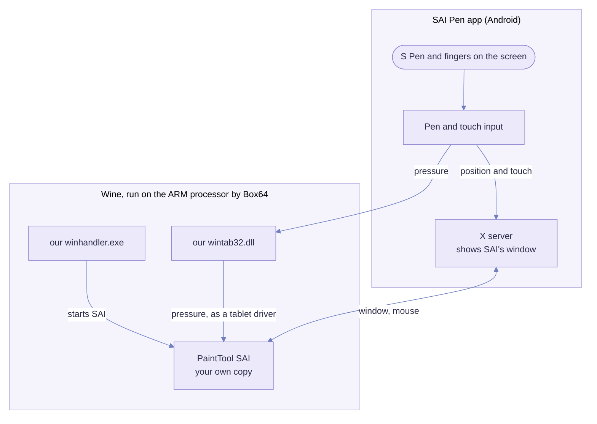

SAI is a Windows program for x86-64 processors. Wine gives it Windows, Box64 turns its x86-64 code
into ARM code as it runs, and Winlator's X server shows its window. The pen goes two ways at once:
the position and the touch as a mouse through the X server, and the pressure (UDP `127.0.0.1:47800`)
straight to our `wintab32.dll` inside SAI, which hands it to SAI the way a Wacom tablet driver
would. The timelapse comes from the app itself: it copies SAI's canvas view out of the X server, as
shown on the screen ([TIMELAPSE-AND-SAI-LICENCE.md](TIMELAPSE-AND-SAI-LICENCE.md)). Our
`winhandler.exe` starts SAI and answers the app (UDP 7946/7947): windows to the front, clipboard,
processor cores, and which of SAI's canvas views is under the pen.

We looked for another way to get S Pen pressure into SAI on Android and did not find one
(November 2026): Winlator and its forks pass the S Pen as a mouse, without pressure.

</details>

<details>
<summary><b>What it changes in Winlator</b></summary>

- **The S Pen is a pen.** In Winlator the S Pen moves the cursor like a laptop touchpad, and a
  pen that is held down and moving never holds the mouse button. Here the cursor sits under the
  tip, touching holds the left button, and the side button gives a right click.
- **Pressure reaches SAI.** Every pen sample, including the ones Android batches together, goes
  over UDP `127.0.0.1:47800` to our `wintab32.dll` inside SAI. That DLL tells SAI the pressure
  through WinTab. Before each session the app copies the DLL into the Wine prefix and sets
  `wintab32=native,builtin`.
- **Fingers.** One finger puts the cursor under itself. Two fingers scroll, zoom and rotate the
  canvas.
- **One screen instead of Winlator's.** No containers to set up: the app finds SAI, prepares
  Wine for it and starts it, and comes back to its own screen when SAI closes.
- **Its own package** (`sai.penpress`), so it installs next to Winlator. Winlator's prebuilt files
  have its own data folder compiled in. The build rewrites that path in place, so the new package
  name must be exactly as long as `com.winlator`.

</details>

## Licences

In short: SAI Pen is free and open source, everything inside it may be passed on, and the source
code of every part is published. Nothing of Microsoft's and no part of SAI is in the app.

<picture>
  <source media="(prefers-color-scheme: dark)" srcset="docs/images/licences-dark.svg">
  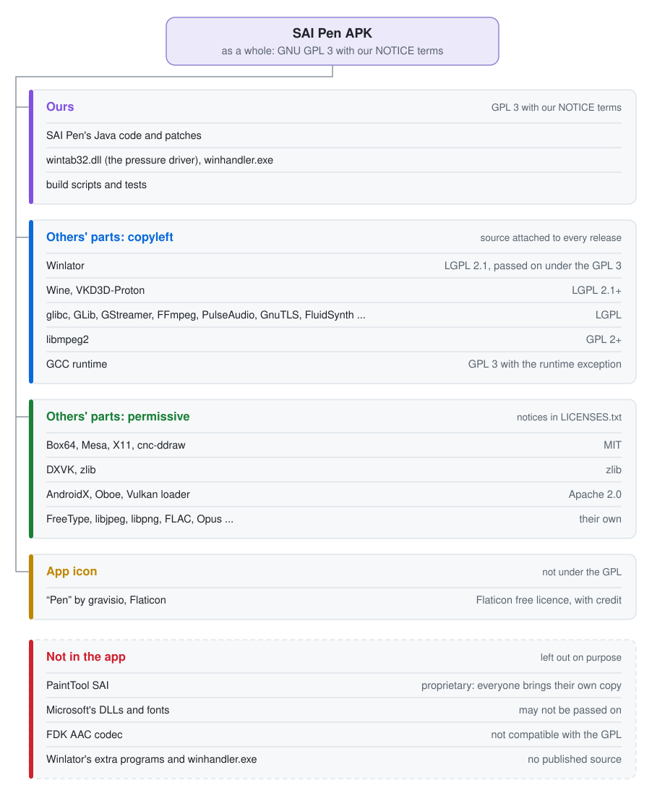
</picture>

**Our code** is licensed under the **GNU General Public License, version 3** ([LICENSE](LICENSE)),
with additional terms under its section 7 ([NOTICE](NOTICE)): keep `NOTICE` and the credit
"SAI Pen Pressure by ametrien" with a link to
<https://github.com/ametrien/Paint-Tool-SAI-pen-pressure-macOS-fix>, and mark a changed version as
changed, not as the original.

**PaintTool SAI** is proprietary software by SYSTEMAX Software Development and is **not**
included: everyone downloads it from SYSTEMAX and uses their own licence. Samsung and S Pen are
trademarks of Samsung Electronics. This project is not affiliated with SYSTEMAX, Samsung or
Winlator.

<details>
<summary><b>The full licence details</b></summary>

The GPL lets anyone use, share and change the app, also for money, as long as whatever they pass
on stays under the same licence with its full source code. Nobody can turn this code into a
closed app.

**What it is built on.** Winlator is LGPL-2.1, and LGPL-2.1 (section 3) allows conveying it under
the GPL, so the whole app goes out under GPL-3.0. Every other part (Wine, Box64, the Linux
libraries, the audio and graphics libraries) keeps its own licence and copyright notice:

- [THIRD_PARTY.md](THIRD_PARTY.md) lists every part inside the APK, its version, its licence and
  where its source is;
- [LICENSES.txt](LICENSES.txt) holds the full text of every licence and every copyright notice.
  The app shows the same file under **Licences**.

**Source code of every part.** Each release carries, next to the APK, the source archive of every
part under the GPL or the LGPL (`SAI-Pen-<version>-sources.tar`, about 400 MB), with a
`SHA256SUMS` file. `tools/fetch-sources.py` downloads the same archives and checks them against
`third_party/sources.tsv`. Our own source is this repository at the release's tag, and `build.sh`
builds the APK from it.

**What is left out, and why.**

- **Microsoft's files.** Winlator ships Microsoft's DirectX parts, Visual C++ runtimes, fonts and
  MFC. Their licences do not let anyone pass them on, so the build removes them, and it fails if
  any of them comes back. SAI does not need them.
- **The Fraunhofer FDK AAC codec.** Its licence does not go with the GPL. SAI does not need it.
- **Winlator's extra programs** (7-Zip, its file manager, test and download tools). SAI does not
  use them, and some have no published source.
- **Winlator's `winhandler.exe`**, the helper that starts SAI inside Wine, as its source is not
  published. SAI Pen has its own, written for this project (`winhandler/`).

**The icon** is "Pen" by gravisio from Flaticon
([Drawing icons created by gravisio - Flaticon](https://www.flaticon.com/free-icons/drawing)),
used under Flaticon's free licence with this credit. It is not under the GPL.

**The timelapse** comes from [cromachina/art-timelapse](https://github.com/cromachina/art-timelapse)
(GPL-3.0), which records SAI's canvas on Windows and Linux. The idea of reading the canvas from the
running SAI, and where to look for it, are theirs. Our recorder, from the
[Mac version](https://github.com/ametrien/Paint-Tool-SAI-pen-pressure-macOS-fix), is our own code:
no code was copied. On a PC, use art-timelapse.

</details>

## Build from source (macOS)

<details>
<summary>Requirements, commands and the repository layout</summary>

Needs JDK 17, the Android SDK with NDK `24.0.8215888`, CMake `3.22.1` and platform 35, and `zstd`.

```bash
./build.sh            # tests, then dist/SAI-Pen-<version>.apk
./build.sh test       # tests only
```

The Winlator checkout lives outside the repository, in `~/Documents/sai-android-build` (change it
with `SAIPEN_WORK`). To change a Winlator file, edit it in `winlator-app/` there, then run
`./build.sh save-patches`.

| Path | What |
|---|---|
| `UPSTREAM` | Winlator repository and commit we build on |
| `patches/winlator.patch` | our changes to Winlator's own files |
| `src/` | our new Java classes (`com.winlator.saipen`), resources and their JVM tests |
| `tools/rewrite_tar.py` | rewrites the data path inside Winlator's archives |
| `tools/make-icon.swift` | draws the app icon: the pen by gravisio from Flaticon on a light tile |
| `winhandler/` | our `winhandler.exe`, which starts SAI inside Wine and answers the app |
| `tools/fetch-sources.py`, `third_party/sources.tsv` | the source archives attached to each release |
| `tests/` | the DLL side of the pen wire check, winhandler's protocol, what the archive rewrite leaves out |
| `third_party/wintab/` | `wintab32.dll` from the macOS project (see `SOURCE.txt`) |

</details>
